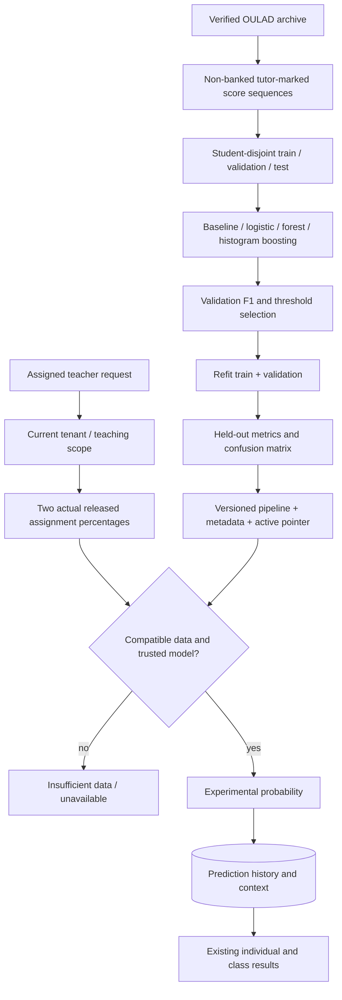

# AI and machine-learning code map

## Contents

- [Current prediction contract](#current-prediction-contract)
- [Files and responsibilities](#files-and-responsibilities)
- [Training and inference flow](#training-and-inference-flow)
- [Where to change ML behavior](#where-to-change-ml-behavior)
- [Evaluation and limits](#evaluation-and-limits)
- [Tests and reproduction references](#tests-and-reproduction-references)

## Current prediction contract

Dataset: [Open University Learning Analytics Dataset v1](https://doi.org/10.6084/m9.figshare.5081998.v1), Kuzilek, Hlosta and Zdrahal, CC BY 4.0. The source records dated tutor-marked assessments, so recorded LMS assignment percentages are a defensible narrow mapping. Attendance, quizzes and LMS activity are not invented as substitutes for source features.

Target: **whether the next submitted assignment scores below 40%**, conditional on submission. Features: `previous_assignment_pct`, `latest_assignment_pct`; schema `oulad-tma-sequence-v1`. Live inputs are the two most recent released/published assignments with distinct past deadlines and recorded submissions. A future published unsubmitted assignment must exist. This does not predict dropout, absence, non-submission or final course failure; 40% is the dataset outcome threshold, not the institute pass mark.

## Files and responsibilities

| File / symbol | Responsibility | Related records / interface |
|---|---|---|
| [ml/oulad.py](../backend/ml/oulad.py): `download`, `prepare`, FEATURES/SCHEMA/TARGET | Pinned publisher archive, checksum validation, allowlisted CSV loading, non-banked TMA filtering and chronological score sequences | Public files in ignored `ml/data/oulad`; no import into LMS tables |
| [ml/train.py](../backend/ml/train.py): `train_oulad`, `metrics`, CLI | Group-disjoint split, preprocessing/candidate fitting, validation-only threshold selection, final fitting, metrics/plot/metadata and atomic active pointer | Existing trusted artifact folder; explicit legacy demo/historical modes retained |
| [ml/inference.py](../backend/ml/inference.py): `status`, `insufficient`, `model_info`, `infer` | File confinement, hash/schema/target checks, trusted joblib load, missing/range checks, probabilities/categories/warnings | No arbitrary model-upload endpoint |
| [prediction_inputs.py](../backend/apps/insights/prediction_inputs.py): `prediction_inputs` | Dispatch by artifact feature schema, read actual released marks, normalize by assignment maximum, preserve evidence | Assignment, Submission; context describes actual source assignments |
| [services.py](../backend/apps/insights/services.py): `student_features` | Legacy aggregate feature extraction only | Do not use this to silently feed the public two-feature model |
| [views.py](../backend/apps/insights/views.py): `model_status`, `predictions`, `require_prediction_instructor` | Status GET, authorized individual POST, filtered/paginated history GET, saved context | Prediction, scoped active Enrollment/Membership |
| [batch.py](../backend/apps/insights/batch.py): `start_analysis`, `scoped_run`, `estimate_row`, `advance_analysis`, `analysis_items` | Persist/resume bounded class run, ten learners per advancement, recheck permissions, deduplicate identical inputs/version/evidence | AnalysisRun, AnalysisItem, Prediction |
| [reporting.py](../backend/apps/insights/reporting.py): `latest_predictions`, `risk_summary` | Current public-version summary; older/different-target predictions remain in history | `/predictions/summary/` |
| [models.py](../backend/apps/insights/models.py) | Prediction values/version/warnings/context; run/item persistence | [0002 batch migration](../backend/apps/insights/migrations/0002_analysisitem_analysisrun_prediction_input_digest_and_more.py), [0003 context migration](../backend/apps/insights/migrations/0003_prediction_context.py) |
| [contracts.py](../backend/apps/insights/contracts.py), [report_contracts.py](../backend/apps/insights/report_contracts.py) | PredictionInput/Result/History/Page and ModelStatusResult contracts | [OpenAPI snapshot](openapi.yaml) |
| [Predictions.tsx](../frontend/src/features/analytics/Predictions.tsx) | Model status, risk summary, individual generation, history and filtering | `/predictions`, course AI insights tab; staff oversight can read |
| [ClassAnalysis.tsx](../frontend/src/features/analytics/ClassAnalysis.tsx) | Analyze Class start/advance loop, progress, results, read-only controls, prediction-basis dialog | `/class-analysis/`, `/{id}/advance/`, `/{id}/items/` |
| [PredictionContext.tsx](../frontend/src/features/analytics/PredictionContext.tsx) | Source, target, metrics, date/input evidence and experimental warning | Saved per-prediction context; preserves historical warning distinctions |
| [CourseDetail.tsx](../frontend/src/features/courses/CourseDetail.tsx) | Existing course AI insights integration | Staff course tab, not a second prediction system |

## Training and inference flow

The artifact is global and trained on public data; prediction records are tenant/course/student scoped. Admin and Head management views inspect existing results, but generation requires an effective Teacher workspace and actual assignment. No automatic penalty, grade edit or progression decision follows inference. There is no queue worker: the UI sends successive bounded advance requests; run state persists if the UI stops.

## Where to change ML behavior

| Change | Inspect first | Must remain coordinated |
|---|---|---|
| Algorithm/hyperparameters | `train_oulad` in train.py | Reproducible split, candidate metadata, validation selection, evaluation documentation |
| Training features/target | oulad.py constants + prepare | prediction_inputs.py, inference schema checks, contracts, UI explanations, new version and negative tests |
| Decision/support thresholds | train.py validation grid and saved thresholds | inference categories, UI labels, model-evaluation.md; do not tune using held-out results |
| Active artifact | `metadata.json` in [artifacts](../backend/ml/artifacts) | Version-named JSON/joblib/hash, trusted directory permissions; never rename an old synthetic model as public-data |
| Individual API/history | insights/views.py, contracts.py, Prediction model | Current scoped lookup, saved context, pagination, legacy history behavior |
| Teacher interface | Predictions.tsx, PredictionContext.tsx | Distinguish actual grades from predictions and show insufficient-data states |
| Class analysis | batch.py + ClassAnalysis.tsx | Active-run/input uniqueness, bounded chunks, assignment revocation checks, no duplicate persistence |

Active version at this checkpoint: `oulad-a90f43b47bbf0041`. [Active metadata](../backend/ml/artifacts/metadata.json) and [versioned JSON](../backend/ml/artifacts/oulad-a90f43b47bbf0041.json) are inspectable. The joblib is an ignored generated artifact, so it may need reproduction on another checkout; its absence must remain an unavailable state. Historical `demo-*` and earlier public artifacts are not deleted or relabeled.

## Evaluation and limits

Source: 173,912 submission rows; 96,916 usable TMA scores; 50,815 sequences from 18,136 students. Train/validation/test rows: 30,485 / 10,176 / 10,154. Final fit uses 40,661 rows. The selected histogram gradient boosting model uses threshold 0.20. Test accuracy 0.919933, precision 0.335320, recall 0.380068, F1 0.356295, ROC-AUC 0.821488, Brier 0.047016; confusion matrix `[[9116,446],[367,225]]` (actual-negative row first).

Always-negative accuracy is 94.17%, higher than the model's 91.99%, but recall/F1 are zero. The selected model's limited precision/recall are explicit. Source grade-release times are absent, so historical availability is assumed. Thirty-seven source windows have input cutoffs on/after the target deadline but before target submission; live future-deadline gating excludes that operational situation. Same-source student holdout is not local, institutional or temporal generalization. No IntelliLMS cohort validation, prospective utility, fairness or local calibration is established. See [full methodology](ml-methodology.md) and [measured evaluation](model-evaluation.md).

## Tests and reproduction references

[test_public_model.py](../backend/tests/test_public_model.py) covers the actual artifact, schema, missing inputs, chronology, real LMS mapping, history, batch reuse and negative permissions. [test_ml.py](../backend/tests/test_ml.py), [test_class_analysis.py](../backend/tests/test_class_analysis.py), [test_auth_and_inference.py](../backend/tests/test_auth_and_inference.py), [test_reporting.py](../backend/tests/test_reporting.py) and [test_response_contracts.py](../backend/tests/test_response_contracts.py) cover legacy compatibility and integration.

[PredictionContext.test.tsx](../frontend/src/features/analytics/PredictionContext.test.tsx), [workflows.test.tsx](../frontend/src/features/workflows.test.tsx) and [real-data-ml.spec.ts](../frontend/e2e/real-data-ml.spec.ts) cover display/read-only controls and actual teacher class/individual/history flows. [e2e-public-model-fixture.py](../scripts/e2e-public-model-fixture.py) adjusts dates only inside the guarded disposable fictional database; it never prepares live student records for a demonstration.

Training/reproduction commands are in [ml-methodology.md](ml-methodology.md#reproduce-training-and-the-demonstration). No model was trained or artifact replaced for this handbook.
