# Backend feature map

Start here to locate the implementation of a visible feature. The complete registered handlers/methods are generated in [API_ENDPOINT_MAP.md](API_ENDPOINT_MAP.md). [WHERE_TO_EDIT.md](WHERE_TO_EDIT.md) adds frontend and regression-test links for each feature; [FEATURE_WORKFLOWS.md](FEATURE_WORKFLOWS.md) traces mutations, validation, audit and the response.

## Request flow

```mermaid
flowchart LR
  Page["React page"] --> API["lib/api.ts: cookie + CSRF"]
  API --> URL["config/urls.py"]
  URL --> View["feature-named view"]
  View --> Scope["accounts/scope.py"]
  Scope --> Validation["serializer + institution/course checks"]
  Validation --> Operation["existing transaction/service"]
  Operation --> ORM["unchanged domain models"]
  ORM --> PG["existing PostgreSQL tables"]
```

All paths below are implementation files. `views/__init__.py` retains old imports but does not duplicate logic. Models and migration identities remain unchanged. A service can remain in a focused module such as `admission.py`; adding a `services/` directory would not improve that already clear boundary.

## Features, validation and operations

| Feature / frontend entry | HTTP implementation | Validation and operation | Data and permission boundary |
|---|---|---|---|
| Institutes / ManageInstitutes, InstituteSettings | [InstituteViewSet](../backend/apps/accounts/views/institutes.py) | [InstituteSerializer](../backend/apps/accounts/serializers/institutes.py), [configuration rules](../backend/apps/accounts/configuration.py) | Institute; platform creation, authorized institute settings; type changes protected |
| Platform overview / PlatformDashboard | [platform](../backend/apps/insights/views/dashboards.py) | Scoped aggregate reads; [platform management](../backend/apps/accounts/platform.py) | Institute, User, Membership; Super Admin |
| Platform settings and audit | [platform.py](../backend/apps/accounts/platform.py) | Existing platform serializers/actions | PlatformConfiguration, User, Django LogEntry; platform rules |
| Login, password setup, institute/workspace selection / Login, Auth, HeadWorkspace | [auth.py](../backend/apps/accounts/auth.py) | [contracts](../backend/apps/accounts/contracts.py), session/CSRF, [Scope](../backend/apps/accounts/scope.py) | User, Membership, sessions; active authorized membership |
| People creation/import/linking / ManagePeople, ImportPeople, LinkAccount | [MembershipViewSet](../backend/apps/accounts/views/memberships.py) | [MembershipSerializer](../backend/apps/accounts/serializers/memberships.py), [importing](../backend/apps/accounts/importing.py), invitation/attach contracts | User, Membership, AccountInvitation; tenant roles validated; no ordinary role escalation |
| Invitation delivery/retry / InvitationReview | [membership actions](../backend/apps/accounts/views/memberships.py) | [invitations.py](../backend/apps/accounts/invitations.py), after-commit delivery, stable account identity, retry coalescing | AccountInvitation, User, Audit; token and transport evidence remain private |
| Staff removal/deactivation/reassignment/Head replacement / StaffLifecycle | [membership actions](../backend/apps/accounts/views/memberships.py) | [TransitionInput, transition, replace_head](../backend/apps/accounts/lifecycle.py) | Membership, Offering.teachers, appointments, Audit; explicit authorized operations, history retained |
| Teacher appointments / TeacherAppointments | [TeacherAppointmentViewSet](../backend/apps/accounts/appointments.py) | AppointmentInput, WithdrawalInput and department eligibility in the same focused module | TeacherAppointment, Membership, Unit; own department/authorized administration; no schools |
| Departments, programs, years, terms, batches, sections, curriculum, subject catalog / named academic pages | [StructureViewSet + STRUCTURES](../backend/apps/academics/views/structures.py) | [TenantSerializer and serializer_for](../backend/apps/academics/serializers.py), [institution rules](../backend/apps/accounts/institution.py) | Unit, Program, Year, Term, AdmissionBatch, Section, CurriculumItem, Course; tenant and kind validation |
| Course creation, archive and teacher assignment / CourseOfferings, CourseOfferingForm | [OfferingViewSet](../backend/apps/academics/views/course_offerings.py) | TenantSerializer; existing eligibility and assignment checks inside the view | Offering, Course, Term, Section, teacher M2M; Admin structure, scoped Head assignment, school direct path |
| Enrollment oversight and bounded mutation / StudentEnrollments, BulkEnrollment | [EnrollmentViewSet](../backend/apps/academics/views/enrollments.py), [EnrollmentActions](../backend/apps/academics/enrollment.py) | BulkEnrollmentInput, candidate eligibility, reason, locks and audit | Enrollment, Membership, Offering; direct CRUD remains rejected |
| Timetable / Timetable | [TimetableViewSet](../backend/apps/academics/views/timetable.py) | TenantSerializer; existing period/conflict validation | Timetable, Offering; scoped reads and authorized schedule management |
| Student admission / StudentAdmission | [admit_student](../backend/apps/academics/admission.py) | AdmissionInput, PlacementInput, validate_placement; existing idempotency/transaction | User, Membership, AdmissionReceipt, StudentPlacement, Enrollment; Institute Admin |
| Placement, transfer and progression / StudentPlacement, StudentProgression | [transfer_student](../backend/apps/academics/admission.py), [progress_student](../backend/apps/academics/progression.py) | TransferInput / ProgressionInput, evidence and current placement validation | StudentPlacement, ProgressionDecision, Enrollment; history preserved |
| Institute setup / InstituteSetup | [setup.py](../backend/apps/academics/setup.py) | Read-only readiness calculations under institution configuration | Academic structures and memberships; scoped administration |
| Course modules and lessons / LearningModules, Lessons, CourseWorkspace | [ModuleViewSet, LessonViewSet](../backend/apps/learning/views/lessons.py) | [LearningSerializer](../backend/apps/learning/serializers.py), [learning base](../backend/apps/learning/views/base.py) | Module, Lesson, Completion, Activity; instructor writes, published/enrolled learner reads |
| Materials/private downloads / LearningMaterials, CourseWorkspace | [MaterialViewSet](../backend/apps/learning/views/materials.py) | validate_upload, related-object scope, authorized FileResponse | Material/private files; no public media exposure |
| Assignments and submissions / Assignments, AssignmentSubmissions, WorkflowDialog | [AssignmentViewSet, SubmissionViewSet](../backend/apps/learning/views/assignments.py) | LearningSerializer, AssignmentSubmitInput, SubmissionGradeInput, marks_value, existing grade locks/history | Assignment, Submission, Enrollment, Audit; own submission and assigned-instructor grading |
| Quizzes, questions and authoring / Quizzes, QuizQuestions, QuizAuthoring | [QuizViewSet, QuestionViewSet](../backend/apps/learning/views/quizzes.py) | LearningSerializer, [QuizAuthoringActions](../backend/apps/learning/authoring.py) | Quiz, Question; instructor authoring, attempt-sensitive mutation protection |
| Question bank / QuestionBank, BankCopy | [BankQuestionViewSet](../backend/apps/learning/views/question_bank.py) | BankCopyInput, LearningSerializer and authored copy checks | BankQuestion, Question; scoped instructors |
| Quiz attempts and marking / QuizAttempt, QuizAttempts, WorkflowDialog | [AttemptViewSet](../backend/apps/learning/views/quiz_attempts.py) | AnswersInput, AttemptGradeInput, attempt_data, score_attempt | Attempt, Quiz, Question; own timed attempts, withheld answers, assigned manual marking |
| Attendance entry/history / AttendanceManagement, AttendanceRecords, AttendanceRoster | [attendance views](../backend/apps/learning/views/attendance.py) | AttendanceInput, [roster](../backend/apps/learning/roster.py), [academic_lock_reason](../backend/apps/learning/policies.py) | AttendanceSession, Attendance, Enrollment; assigned entry, scoped oversight and own history |
| Manual marks / ManualGrades | [ManualGradeViewSet](../backend/apps/learning/views/grading.py) | LearningSerializer, marks_value, finalized/released policy | ManualGrade; assigned instructor, protected history |
| Grade release/finalization and corrections / AcademicControl, AcademicReviews | [governance.py](../backend/apps/learning/governance.py) plus relevant assessment view | RecordInput, FinalizeInput, CorrectionInput, DecisionInput; proposal/snapshot/staleness checks, reviewer and can_review_request | Submission, Attempt, ManualGrade, Attendance, CorrectionRequest, Audit; delegated independent review |
| Gradebook/GPA/academic history / Gradebook, AcademicHistory | [grade reports](../backend/apps/insights/views/grade_reports.py), [academic_results](../backend/apps/insights/academic_results.py), [progression history](../backend/apps/academics/progression.py) | [gradebook](../backend/apps/insights/gradebook.py), configured policy/credits, report filters/contracts | Released results and enrollments; students own results, authorized staff scope |
| Dashboards, comparisons, workload and progress / role dashboards, Trends | [dashboard views](../backend/apps/insights/views/dashboards.py), [reporting](../backend/apps/insights/reporting.py), [course reports](../backend/apps/insights/course_reports.py), [workload](../backend/apps/insights/workload.py) | [filters](../backend/apps/insights/filters.py), report contracts, scoped SQL aggregates | Offering, Enrollment, academic records; role-specific scope, bounded pagination |
| Predictions and class analysis / Predictions, ClassAnalysis | [prediction views](../backend/apps/insights/views/predictions.py), [batch](../backend/apps/insights/batch.py) | PredictionInput, [prediction_inputs](../backend/apps/insights/prediction_inputs.py), [readiness](../backend/apps/insights/readiness.py), existing inference | Prediction, AnalysisRun, AnalysisItem; read-only Admin, authorized instructor generation |
| Announcements / Announcements | [AnnouncementViewSet](../backend/apps/learning/views/announcements.py) | LearningSerializer and existing publication/audience checks | Announcement; scoped management/teaching and visible learner reads |
| Notifications / Notifications, StudentPriorities | [NotificationViewSet](../backend/apps/learning/views/notifications.py), [agenda](../backend/apps/insights/agenda.py) | [notify_event](../backend/apps/learning/notifications.py), existing reminder management command | Notification and deadline/academic context; self scope, no direct client creation |
| Profile and avatar / Profile, ProfilePicture | [auth.py](../backend/apps/accounts/auth.py), [profile.py](../backend/apps/accounts/profile.py) | Existing profile/password validation and image verification | User and private avatar file; self only |
| Institute audit / InstituteAudit | [AuditViewSet](../backend/apps/insights/views/audit.py) | Read-only scoped queryset; audits created by existing services | Audit; institute administration, no automatic assumption of universal audit coverage |

Every row shares session authentication and the relevant Scope checks. Public platform configuration and explicitly public authentication/bootstrap endpoints are documented exceptions, not reasons to bypass tenant validation elsewhere. See the [permissions guide](ROLES_AND_PERMISSIONS.md).

## Where tests and contracts live

[WHERE_TO_EDIT.md](WHERE_TO_EDIT.md) links the exact backend/browser tests protecting each feature. Action serializers are in the existing accounts/learning/insights contract modules; generated structure serializers still come from `serializer_for`. The generated endpoint map identifies static serializers when available, and [openapi.yaml](openapi.yaml) remains the complete request/response contract snapshot.

API URL registration is unchanged. For this refactor, the entire generated OpenAPI is compared with a baseline, not rewritten simply because handler files moved.
