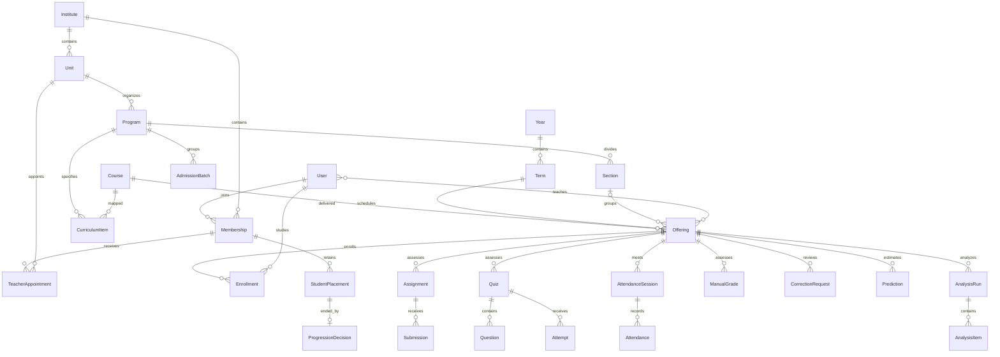

# Database model and relationship guide

## Contents

- [Naming and scope](#naming-and-scope)
- [Accounts models](#accounts-models)
- [Academics models](#academics-models)
- [Learning models](#learning-models)
- [Insights models](#insights-models)
- [Major relationships](#major-relationships)
- [Migrations](#migrations)
- [Derived results and safe changes](#derived-results-and-safe-changes)

## Naming and scope

There are **41 concrete project models**: accounts 6, academics 14, learning 16, insights 5. Django also supplies auth permissions/groups, sessions, content types and admin LogEntry. Auto-created many-to-many through tables are not additional project model classes. [TenantModel](../backend/apps/accounts/models.py) and [OfferingRecord](../backend/apps/learning/models.py) are abstract.

“Department” is `Unit`; a school “Class” is `Program`; “Subject” is `Course`; a delivered class is `Offering`; an academic period is `Term`. Do not add duplicate Department/Class/Subject/Semester models to solve a terminology issue. Teacher/student roles belong to Membership; there are no separate Teacher or Student tables.

TenantModel-derived rows inherit `id` (UUID), `institute` (FK to Institute) and `created_at`. OfferingRecord also supplies `offering` (FK). These common fields are omitted from the field lists below but are real persisted fields. A database FK alone does not prove that both rows share an institute: serializers/services enforce cross-tenant consistency. “No named constraint” means no explicit model Meta constraint, not no field validation or primary key.

Field-level uniqueness also applies: User.username (inherited) and User.email are unique, Institute.code is unique, AccountInvitation.user is one-to-one, and ProgressionDecision.previous is one-to-one. Program duration and curriculum/placement stages have bounded validators; Course.credit_hours has numeric validators; additional cross-field/date/marks constraints are in serializers and services. These are not all represented as named SQL constraints.

## Accounts models

Source for every entry in this section: [accounts/models.py](../backend/apps/accounts/models.py). API paths below are relative to `/api/v1/`; see [endpoint catalog](BACKEND_CODE_MAP.md#complete-endpoint-catalog) for methods and enforcement.

### User

Global login identity, profile image and notification preference.

| Aspect | Source-backed mapping |
|---|---|
| Important fields | `is_superuser`, `username`, `first_name`, `last_name`, `is_active`, `email`, `avatar`, `notify_academic` |
| Relationships | No domain foreign keys. |
| Named constraints | No named Meta constraint; inspect field validators and serializers. |
| API users | `auth/me/`; `auth/avatar/`; `platform-users/` |
| Frontend entry | [Profile.tsx](../frontend/src/features/auth/Profile.tsx); related resource/config screens are indexed in [frontend map](FRONTEND_PAGE_MAP.md) |

### Institute

Tenant boundary, type, branding terminology and grading/policy JSON.

| Aspect | Source-backed mapping |
|---|---|
| Important fields | `name`, `code`, `kind` (school, college, university, other), `active`, `terminology`, `grading_rules` |
| Relationships | No domain foreign keys. |
| Named constraints | No named Meta constraint; inspect field validators and serializers. |
| API users | `institutes/`; `platform/` |
| Frontend entry | [Platform.tsx](../frontend/src/features/analytics/Platform.tsx); related resource/config screens are indexed in [frontend map](FRONTEND_PAGE_MAP.md) |

### PlatformConfiguration

Singleton public platform name/support/login notice.

| Aspect | Source-backed mapping |
|---|---|
| Important fields | `platform_name`, `support_email`, `login_notice`, `updated_at` |
| Relationships | No domain foreign keys. |
| Named constraints | `CheckConstraint: condition=(AND: ('id', 1)) name='single_platform_configuration'` |
| API users | `platform-settings/` |
| Frontend entry | [PlatformSettings.tsx](../frontend/src/features/auth/PlatformSettings.tsx); related resource/config screens are indexed in [frontend map](FRONTEND_PAGE_MAP.md) |

### Membership

One user role per institute, student identity/section and teaching eligibility.

| Aspect | Source-backed mapping |
|---|---|
| Important fields | `user`, `role` (admin, head, teacher, student), `unit`, `active`, `removed_at`, `display_name`, `student_identifier`, `section`, `can_teach`, `eligible_units` |
| Relationships | `user` → accounts.User; `unit` → academics.Unit (optional); `section` → academics.Section (optional); `eligible_units` → academics.Unit (M2M) |
| Named constraints | `UniqueConstraint: fields=('user', 'institute') name='unique_membership'` `UniqueConstraint: fields=('institute', 'student_identifier') name='unique_institute_student_identifier' condition=(NOT (AND: ('student_identifier', '')))` |
| API users | `memberships/` |
| Frontend entry | [ResourcePage.tsx](../frontend/src/features/resources/ResourcePage.tsx); related resource/config screens are indexed in [frontend map](FRONTEND_PAGE_MAP.md) |

### TeacherAppointment

Audited active/withdrawn department appointment of a teaching member.

| Aspect | Source-backed mapping |
|---|---|
| Important fields | `membership`, `unit`, `active`, `reason`, `updated_at` |
| Relationships | `membership` → accounts.Membership; `unit` → academics.Unit |
| Named constraints | `UniqueConstraint: fields=('membership', 'unit') name='unique_department_teacher_appointment'` |
| API users | `teacher-appointments/` |
| Frontend entry | [TeacherAppointments.tsx](../frontend/src/features/resources/TeacherAppointments.tsx); related resource/config screens are indexed in [frontend map](FRONTEND_PAGE_MAP.md) |

### AccountInvitation

Versioned password-setup invitation and transport/acceptance state.

| Aspect | Source-backed mapping |
|---|---|
| Important fields | `user`, `version`, `issued_at`, `expires_at`, `accepted_at`, `email_status` (pending, sent, failed) |
| Relationships | `user` → accounts.User (one-to-one) |
| Named constraints | No named Meta constraint; inspect field validators and serializers. |
| API users | `memberships/{id}/resend-invitation/`; `auth/password-confirm/` |
| Frontend entry | [InvitationReview.tsx](../frontend/src/features/resources/InvitationReview.tsx); related resource/config screens are indexed in [frontend map](FRONTEND_PAGE_MAP.md) |

## Academics models

Source for every entry in this section: [academics/models.py](../backend/apps/academics/models.py). API paths below are relative to `/api/v1/`; see [endpoint catalog](BACKEND_CODE_MAP.md#complete-endpoint-catalog) for methods and enforcement.

### Unit

Department or hierarchical academic unit; schools reject this structure.

| Aspect | Source-backed mapping |
|---|---|
| Important fields | `name`, `kind`, `parent` |
| Relationships | `parent` → academics.Unit (optional) |
| Named constraints | `UniqueConstraint: fields=('institute', 'name') name='unique_unit'` |
| API users | `units/` |
| Frontend entry | [Academics.tsx](../frontend/src/features/resources/Academics.tsx); related resource/config screens are indexed in [frontend map](FRONTEND_PAGE_MAP.md) |

### Year

Institute academic calendar year.

| Aspect | Source-backed mapping |
|---|---|
| Important fields | `name`, `start`, `end` |
| Relationships | No domain foreign keys. |
| Named constraints | `UniqueConstraint: fields=('institute', 'name') name='unique_year'` `CheckConstraint: condition=(AND: ('end__gte', F(start))) name='year_dates'` |
| API users | `years/` |
| Frontend entry | [Academics.tsx](../frontend/src/features/resources/Academics.tsx); related resource/config screens are indexed in [frontend map](FRONTEND_PAGE_MAP.md) |

### Term

Academic period with type, lifecycle status and dates within a year.

| Aspect | Source-backed mapping |
|---|---|
| Important fields | `period_type` (blank, annual, semester), `status` (planned, active, closed), `name`, `year`, `start`, `end` |
| Relationships | `year` → academics.Year |
| Named constraints | `UniqueConstraint: fields=('year', 'name') name='unique_term'` `CheckConstraint: condition=(AND: ('end__gte', F(start))) name='term_dates'` |
| API users | `terms/` |
| Frontend entry | [Academics.tsx](../frontend/src/features/resources/Academics.tsx); related resource/config screens are indexed in [frontend map](FRONTEND_PAGE_MAP.md) |

### Program

Degree/college stream or school class; configured structure and duration.

| Aspect | Source-backed mapping |
|---|---|
| Important fields | `duration_terms`, `structure` (semester, annual), `active`, `name`, `unit` |
| Relationships | `unit` → academics.Unit (optional) |
| Named constraints | `UniqueConstraint: fields=('institute', 'unit', 'name') name='unique_program_unit'` `UniqueConstraint: fields=('institute', 'name') name='unique_program_without_unit' condition=(AND: ('unit__isnull', True))` |
| API users | `programs/` |
| Frontend entry | [Academics.tsx](../frontend/src/features/resources/Academics.tsx); related resource/config screens are indexed in [frontend map](FRONTEND_PAGE_MAP.md) |

### Section

Division of a program/class, optionally linked to a batch.

| Aspect | Source-backed mapping |
|---|---|
| Important fields | `batch`, `active`, `name`, `program` |
| Relationships | `batch` → academics.AdmissionBatch (optional); `program` → academics.Program |
| Named constraints | `UniqueConstraint: fields=('program', 'name') name='unique_section_program'` |
| API users | `sections/` |
| Frontend entry | [Academics.tsx](../frontend/src/features/resources/Academics.tsx); related resource/config screens are indexed in [frontend map](FRONTEND_PAGE_MAP.md) |

### Course

Reusable subject/catalog definition, optional credits and unit.

| Aspect | Source-backed mapping |
|---|---|
| Important fields | `credit_hours`, `active`, `code`, `name`, `description`, `unit` |
| Relationships | `unit` → academics.Unit (optional) |
| Named constraints | `UniqueConstraint: fields=('institute', 'code') name='unique_course_code'` |
| API users | `courses/` |
| Frontend entry | [Academics.tsx](../frontend/src/features/resources/Academics.tsx); related resource/config screens are indexed in [frontend map](FRONTEND_PAGE_MAP.md) |

### Offering

Delivered subject in a period/section with teachers, weights and correction delegation.

| Aspect | Source-backed mapping |
|---|---|
| Important fields | `head_correction_review`, `course`, `term`, `section`, `title`, `archived`, `assignment_weight`, `quiz_weight`, `manual_weight`, `teachers` |
| Relationships | `course` → academics.Course; `term` → academics.Term; `section` → academics.Section (optional); `teachers` → accounts.User (M2M) |
| Named constraints | `CheckConstraint: condition=(AND: ('assignment_weight', CombinedExpression: Value(100) - F(quiz_weight) - F(manual_weight))) name='weights_total_100'` |
| API users | `offerings/` |
| Frontend entry | [CourseDetail.tsx](../frontend/src/features/courses/CourseDetail.tsx); related resource/config screens are indexed in [frontend map](FRONTEND_PAGE_MAP.md) |

### Enrollment

Retained student-offering membership; withdrawal flips active.

| Aspect | Source-backed mapping |
|---|---|
| Important fields | `offering`, `student`, `active` |
| Relationships | `offering` → academics.Offering; `student` → accounts.User |
| Named constraints | `UniqueConstraint: fields=('offering', 'student') name='unique_enrollment'` |
| API users | `enrollments/`; `offerings/{id}/bulk-enrollment/` |
| Frontend entry | [BulkEnrollment.tsx](../frontend/src/features/courses/BulkEnrollment.tsx); related resource/config screens are indexed in [frontend map](FRONTEND_PAGE_MAP.md) |

### Timetable

Day/time/location for an offering.

| Aspect | Source-backed mapping |
|---|---|
| Important fields | `offering`, `day` (0, 1, 2, 3, 4, 5, 6), `start`, `end`, `location` |
| Relationships | `offering` → academics.Offering |
| Named constraints | `CheckConstraint: condition=(AND: ('end__gt', F(start))) name='meeting_times'` |
| API users | `timetable/` |
| Frontend entry | [ResourcePage.tsx](../frontend/src/features/resources/ResourcePage.tsx); related resource/config screens are indexed in [frontend map](FRONTEND_PAGE_MAP.md) |

### AdmissionBatch

Entry cohort for a program/year.

| Aspect | Source-backed mapping |
|---|---|
| Important fields | `name`, `program`, `year`, `active` |
| Relationships | `program` → academics.Program; `year` → academics.Year |
| Named constraints | `UniqueConstraint: fields=('program', 'name') name='unique_admission_batch_program'` |
| API users | `batches/` |
| Frontend entry | [Academics.tsx](../frontend/src/features/resources/Academics.tsx); related resource/config screens are indexed in [frontend map](FRONTEND_PAGE_MAP.md) |

### CurriculumItem

Required/elective subject mapped to a program stage.

| Aspect | Source-backed mapping |
|---|---|
| Important fields | `program`, `course`, `stage`, `required`, `active` |
| Relationships | `program` → academics.Program; `course` → academics.Course |
| Named constraints | `UniqueConstraint: fields=('program', 'course', 'stage') name='unique_curriculum_subject_stage'` |
| API users | `curriculum/` |
| Frontend entry | [Academics.tsx](../frontend/src/features/resources/Academics.tsx); related resource/config screens are indexed in [frontend map](FRONTEND_PAGE_MAP.md) |

### StudentPlacement

Current or ended academic placement with actor/reason.

| Aspect | Source-backed mapping |
|---|---|
| Important fields | `stage`, `term`, `end_reason` (blank, transfer, progress, repeat, correct, withdraw, complete, graduate), `membership`, `program`, `batch`, `year`, `section`, `ended_at`, `reason`, `actor` |
| Relationships | `term` → academics.Term (optional); `membership` → accounts.Membership; `program` → academics.Program; `batch` → academics.AdmissionBatch (optional); `year` → academics.Year (optional); `section` → academics.Section (optional); `actor` → accounts.User (optional) |
| Named constraints | `UniqueConstraint: fields=('membership',) name='one_current_student_placement' condition=(AND: ('ended_at__isnull', True))` |
| API users | `memberships/{id}/placements/`; `memberships/{id}/transfer/` |
| Frontend entry | [StudentAdmission.tsx](../frontend/src/features/resources/StudentAdmission.tsx); related resource/config screens are indexed in [frontend map](FRONTEND_PAGE_MAP.md) |

### AdmissionReceipt

Tenant idempotency key/digest tying a submitted admission to its member.

| Aspect | Source-backed mapping |
|---|---|
| Important fields | `key`, `membership`, `digest` |
| Relationships | `membership` → accounts.Membership |
| Named constraints | `UniqueConstraint: fields=('institute', 'key') name='unique_admission_request'` |
| API users | `admissions/` |
| Frontend entry | [StudentAdmission.tsx](../frontend/src/features/resources/StudentAdmission.tsx); related resource/config screens are indexed in [frontend map](FRONTEND_PAGE_MAP.md) |

### ProgressionDecision

Persisted reviewed progression/repetition/correction/terminal decision and evidence.

| Aspect | Source-backed mapping |
|---|---|
| Important fields | `membership`, `previous`, `placement`, `operation` (progress, repeat, correct, withdraw, complete, graduate), `reason`, `actor`, `evidence` |
| Relationships | `membership` → accounts.Membership; `previous` → academics.StudentPlacement (one-to-one); `placement` → academics.StudentPlacement (optional); `actor` → accounts.User (optional) |
| Named constraints | No named Meta constraint; inspect field validators and serializers. |
| API users | `memberships/{id}/progress/`; `academic-decisions/` |
| Frontend entry | [StudentProgression.tsx](../frontend/src/features/resources/StudentProgression.tsx); related resource/config screens are indexed in [frontend map](FRONTEND_PAGE_MAP.md) |

## Learning models

Source for every entry in this section: [learning/models.py](../backend/apps/learning/models.py). API paths below are relative to `/api/v1/`; see [endpoint catalog](BACKEND_CODE_MAP.md#complete-endpoint-catalog) for methods and enforcement.

### Module

Ordered learning-content group inside an offering.

| Aspect | Source-backed mapping |
|---|---|
| Important fields | `offering`, `title`, `position` |
| Relationships | `offering` → academics.Offering |
| Named constraints | No named Meta constraint; inspect field validators and serializers. |
| API users | `modules/` |
| Frontend entry | [ResourcePage.tsx](../frontend/src/features/resources/ResourcePage.tsx); related resource/config screens are indexed in [frontend map](FRONTEND_PAGE_MAP.md) |

### Lesson

Published/scheduled body/video lesson, optionally within module.

| Aspect | Source-backed mapping |
|---|---|
| Important fields | `offering`, `module`, `title`, `body`, `video_url`, `position`, `published`, `visible_at` |
| Relationships | `offering` → academics.Offering; `module` → learning.Module (optional) |
| Named constraints | No named Meta constraint; inspect field validators and serializers. |
| API users | `lessons/`; `lessons/{id}/complete/` |
| Frontend entry | [WorkflowDialog.tsx](../frontend/src/features/resources/WorkflowDialog.tsx); related resource/config screens are indexed in [frontend map](FRONTEND_PAGE_MAP.md) |

### Completion

Student lesson completion, unique per lesson/student.

| Aspect | Source-backed mapping |
|---|---|
| Important fields | `lesson`, `student` |
| Relationships | `lesson` → learning.Lesson; `student` → accounts.User |
| Named constraints | `UniqueConstraint: fields=('lesson', 'student') name='unique_completion'` |
| API users | `lessons/{id}/complete/`; `analytics/learner-progress/` |
| Frontend entry | [WorkflowDialog.tsx](../frontend/src/features/resources/WorkflowDialog.tsx); related resource/config screens are indexed in [frontend map](FRONTEND_PAGE_MAP.md) |

### Material

Private downloadable file associated with lesson and offering.

| Aspect | Source-backed mapping |
|---|---|
| Important fields | `offering`, `lesson`, `title`, `file` |
| Relationships | `offering` → academics.Offering; `lesson` → learning.Lesson |
| Named constraints | No named Meta constraint; inspect field validators and serializers. |
| API users | `materials/`; `materials/{id}/download/` |
| Frontend entry | [ResourcePage.tsx](../frontend/src/features/resources/ResourcePage.tsx); related resource/config screens are indexed in [frontend map](FRONTEND_PAGE_MAP.md) |

### Assignment

Published assignment, maximum marks, deadline and submission rules.

| Aspect | Source-backed mapping |
|---|---|
| Important fields | `offering`, `title`, `description`, `file`, `max_marks`, `due_at`, `published`, `allow_late`, `allow_resubmit` |
| Relationships | `offering` → academics.Offering |
| Named constraints | `CheckConstraint: condition=(AND: ('max_marks__gt', 0)) name='assignment_positive_marks'` |
| API users | `assignments/` |
| Frontend entry | [ResourcePage.tsx](../frontend/src/features/resources/ResourcePage.tsx); related resource/config screens are indexed in [frontend map](FRONTEND_PAGE_MAP.md) |

### Submission

Student work, submission date, release/grade/feedback and finalization state.

| Aspect | Source-backed mapping |
|---|---|
| Important fields | `finalized`, `assignment`, `student`, `text`, `file`, `submitted_at`, `late`, `marks`, `feedback`, `released` |
| Relationships | `assignment` → learning.Assignment; `student` → accounts.User |
| Named constraints | `UniqueConstraint: fields=('assignment', 'student') name='unique_submission'` |
| API users | `assignments/{id}/submit/`; `submissions/` |
| Frontend entry | [WorkflowDialog.tsx](../frontend/src/features/resources/WorkflowDialog.tsx); related resource/config screens are indexed in [frontend map](FRONTEND_PAGE_MAP.md) |

### Quiz

Timed/windowed assessment with attempt and release settings.

| Aspect | Source-backed mapping |
|---|---|
| Important fields | `offering`, `title`, `published`, `opens_at`, `closes_at`, `minutes`, `attempt_limit`, `released` |
| Relationships | `offering` → academics.Offering |
| Named constraints | `CheckConstraint: condition=(AND: ('closes_at__gt', F(opens_at))) name='quiz_window'` `CheckConstraint: condition=(AND: ('attempt_limit__gt', 0), ('minutes__gt', 0)) name='quiz_limits'` |
| API users | `quizzes/` |
| Frontend entry | [QuizAuthoring.tsx](../frontend/src/features/quizzes/QuizAuthoring.tsx); related resource/config screens are indexed in [frontend map](FRONTEND_PAGE_MAP.md) |

### Question

Ordered MCQ, boolean or short-answer item belonging to a quiz.

| Aspect | Source-backed mapping |
|---|---|
| Important fields | `position`, `quiz`, `prompt`, `kind` (mcq, boolean, short), `options`, `answer`, `marks` |
| Relationships | `quiz` → learning.Quiz |
| Named constraints | No named Meta constraint; inspect field validators and serializers. |
| API users | `questions/`; `quizzes/{id}/bulk-questions/` |
| Frontend entry | [QuizAuthoring.tsx](../frontend/src/features/quizzes/QuizAuthoring.tsx); related resource/config screens are indexed in [frontend map](FRONTEND_PAGE_MAP.md) |

### BankQuestion

Reusable author/unit-scoped question copied into assessments.

| Aspect | Source-backed mapping |
|---|---|
| Important fields | `author`, `unit`, `prompt`, `kind` (mcq, boolean, short), `options`, `answer`, `marks` |
| Relationships | `author` → accounts.User; `unit` → academics.Unit (optional) |
| Named constraints | No named Meta constraint; inspect field validators and serializers. |
| API users | `question-bank/` |
| Frontend entry | [BankCopy.tsx](../frontend/src/features/quizzes/BankCopy.tsx); related resource/config screens are indexed in [frontend map](FRONTEND_PAGE_MAP.md) |

### Attempt

Student quiz session, server deadline, answers, automatic/manual marks.

| Aspect | Source-backed mapping |
|---|---|
| Important fields | `finalized`, `quiz`, `student`, `started_at`, `deadline`, `submitted_at`, `answers`, `marks`, `manual_marks` |
| Relationships | `quiz` → learning.Quiz; `student` → accounts.User |
| Named constraints | No named Meta constraint; inspect field validators and serializers. |
| API users | `attempts/`; `quizzes/{id}/start/` |
| Frontend entry | [QuizAttempt.tsx](../frontend/src/features/quizzes/QuizAttempt.tsx); related resource/config screens are indexed in [frontend map](FRONTEND_PAGE_MAP.md) |

### AttendanceSession

Dated class meeting and finalization lock.

| Aspect | Source-backed mapping |
|---|---|
| Important fields | `offering`, `finalized`, `date`, `title` |
| Relationships | `offering` → academics.Offering |
| Named constraints | `UniqueConstraint: fields=('offering', 'date', 'title') name='unique_meeting'` |
| API users | `attendance-sessions/` |
| Frontend entry | [AttendanceRoster.tsx](../frontend/src/features/resources/AttendanceRoster.tsx); related resource/config screens are indexed in [frontend map](FRONTEND_PAGE_MAP.md) |

### Attendance

One recorded status for a student and meeting.

| Aspect | Source-backed mapping |
|---|---|
| Important fields | `session`, `student`, `status` (present, absent, late, excused) |
| Relationships | `session` → learning.AttendanceSession; `student` → accounts.User |
| Named constraints | `UniqueConstraint: fields=('session', 'student') name='unique_attendance'` |
| API users | `attendance/`; `attendance-sessions/{id}/mark/` |
| Frontend entry | [AttendanceRoster.tsx](../frontend/src/features/resources/AttendanceRoster.tsx); related resource/config screens are indexed in [frontend map](FRONTEND_PAGE_MAP.md) |

### Announcement

Published institute, unit or offering message.

| Aspect | Source-backed mapping |
|---|---|
| Important fields | `title`, `body`, `unit`, `offering`, `published` |
| Relationships | `unit` → academics.Unit (optional); `offering` → academics.Offering (optional) |
| Named constraints | No named Meta constraint; inspect field validators and serializers. |
| API users | `announcements/` |
| Frontend entry | [ResourcePage.tsx](../frontend/src/features/resources/ResourcePage.tsx); related resource/config screens are indexed in [frontend map](FRONTEND_PAGE_MAP.md) |

### ManualGrade

Released or draft practical/oral/other manual assessment score.

| Aspect | Source-backed mapping |
|---|---|
| Important fields | `offering`, `finalized`, `student`, `title`, `marks`, `max_marks`, `feedback`, `released` |
| Relationships | `offering` → academics.Offering; `student` → accounts.User |
| Named constraints | `CheckConstraint: condition=(AND: ('marks__gte', 0), ('marks__lte', F(max_marks)), ('max_marks__gt', 0)) name='manual_grade_range'` `UniqueConstraint: fields=('offering', 'student', 'title') name='unique_manual_grade'` |
| API users | `manual-grades/` |
| Frontend entry | [ResourcePage.tsx](../frontend/src/features/resources/ResourcePage.tsx); related resource/config screens are indexed in [frontend map](FRONTEND_PAGE_MAP.md) |

### Notification

User/institute scoped in-app event, read state and destination.

| Aspect | Source-backed mapping |
|---|---|
| Important fields | `destination`, `user`, `title`, `body`, `read`, `event_key` |
| Relationships | `user` → accounts.User |
| Named constraints | `UniqueConstraint: fields=('user', 'institute', 'event_key') name='unique_notification_event'` |
| API users | `notifications/`; `notifications/{id}/read/` |
| Frontend entry | [ResourcePage.tsx](../frontend/src/features/resources/ResourcePage.tsx); related resource/config screens are indexed in [frontend map](FRONTEND_PAGE_MAP.md) |

### CorrectionRequest

Original/proposed record snapshot with requester/reviewer and decision.

| Aspect | Source-backed mapping |
|---|---|
| Important fields | `offering`, `kind` (submission, attempt, manual, attendance), `target`, `requester`, `reviewer`, `original`, `proposed`, `reason`, `decision_reason`, `status` (pending, approved, rejected), `decided_at`, `emergency` |
| Relationships | `offering` → academics.Offering; `requester` → accounts.User; `reviewer` → accounts.User (optional) |
| Named constraints | No named Meta constraint; inspect field validators and serializers. |
| API users | `corrections/`; `academic-control/` |
| Frontend entry | [AcademicControl.tsx](../frontend/src/features/resources/AcademicControl.tsx); related resource/config screens are indexed in [frontend map](FRONTEND_PAGE_MAP.md) |

## Insights models

Source for every entry in this section: [insights/models.py](../backend/apps/insights/models.py). API paths below are relative to `/api/v1/`; see [endpoint catalog](BACKEND_CODE_MAP.md#complete-endpoint-catalog) for methods and enforcement.

### Activity

Recorded learning event used as actual analytics context.

| Aspect | Source-backed mapping |
|---|---|
| Important fields | `user`, `offering`, `kind` |
| Relationships | `user` → accounts.User; `offering` → academics.Offering |
| Named constraints | No named Meta constraint; inspect field validators and serializers. |
| API users | `analytics/`; `analytics/trends/` |
| Frontend entry | [Trends.tsx](../frontend/src/features/analytics/Trends.tsx); related resource/config screens are indexed in [frontend map](FRONTEND_PAGE_MAP.md) |

### Audit

Institutional actor/action/object/detail history.

| Aspect | Source-backed mapping |
|---|---|
| Important fields | `actor`, `action`, `object_id`, `detail` |
| Relationships | `actor` → accounts.User (optional) |
| Named constraints | No named Meta constraint; inspect field validators and serializers. |
| API users | `audit/` |
| Frontend entry | [ResourcePage.tsx](../frontend/src/features/resources/ResourcePage.tsx); related resource/config screens are indexed in [frontend map](FRONTEND_PAGE_MAP.md) |

### Prediction

Versioned probability, feature snapshot, warning, digest and context.

| Aspect | Source-backed mapping |
|---|---|
| Important fields | `student`, `offering`, `probability`, `category`, `version`, `features`, `warning`, `input_digest`, `context` |
| Relationships | `student` → accounts.User; `offering` → academics.Offering |
| Named constraints | `UniqueConstraint: fields=('offering', 'student', 'input_digest') name='unique_prediction_input' condition=(NOT (AND: ('input_digest', '')))` |
| API users | `predictions/` |
| Frontend entry | [Predictions.tsx](../frontend/src/features/analytics/Predictions.tsx); related resource/config screens are indexed in [frontend map](FRONTEND_PAGE_MAP.md) |

### AnalysisRun

Persistent class-analysis request and lifecycle.

| Aspect | Source-backed mapping |
|---|---|
| Important fields | `offering`, `requested_by`, `status`, `finished_at` |
| Relationships | `offering` → academics.Offering; `requested_by` → accounts.User |
| Named constraints | `UniqueConstraint: fields=('offering',) name='one_active_class_analysis' condition=(AND: ('status', 'active'))` |
| API users | `class-analysis/` |
| Frontend entry | [ClassAnalysis.tsx](../frontend/src/features/analytics/ClassAnalysis.tsx); related resource/config screens are indexed in [frontend map](FRONTEND_PAGE_MAP.md) |

### AnalysisItem

One learner's pending/ready/insufficient/failed result in a class run.

| Aspect | Source-backed mapping |
|---|---|
| Important fields | `run`, `student`, `status`, `result` |
| Relationships | `run` → insights.AnalysisRun; `student` → accounts.User |
| Named constraints | `UniqueConstraint: fields=('run', 'student') name='one_student_per_analysis'` |
| API users | `class-analysis/{id}/items/` |
| Frontend entry | [ClassAnalysis.tsx](../frontend/src/features/analytics/ClassAnalysis.tsx); related resource/config screens are indexed in [frontend map](FRONTEND_PAGE_MAP.md) |

## Major relationships

Cardinalities show key ownership paths. Optional fields and protective deletion rules are specified in source. Tenant FKs exist on domain rows even where omitted here to keep the diagram readable.

Additional relations: Module → Lesson → Material; Lesson + User → Completion; User → AccountInvitation (one-to-one); Notification → User + Institute; Audit → optional actor + Institute. CorrectionRequest.target is a UUID interpreted by its kind, **not a database FK to the corrected row**. Original/proposed JSON provides the reviewed evidence. ProgressionDecision.previous is one-to-one; its optional placement points to the next placement.

## Migrations

| App / migration | Main responsibility |
|---|---|
| [accounts/0001_initial.py](../backend/apps/accounts/migrations/0001_initial.py) | Base custom identity, institute/membership and tenant structure. |
| [accounts/0002_institute_grading_rules.py](../backend/apps/accounts/migrations/0002_institute_grading_rules.py) | Institute grading-rules JSON. |
| [accounts/0003_platformconfiguration.py](../backend/apps/accounts/migrations/0003_platformconfiguration.py) | Singleton public platform configuration. |
| [accounts/0004_membership_can_teach_membership_display_name_and_more.py](../backend/apps/accounts/migrations/0004_membership_can_teach_membership_display_name_and_more.py) | Teaching capability, display/student identity and retained removal state. |
| [accounts/0005_user_avatar_user_notify_academic.py](../backend/apps/accounts/migrations/0005_user_avatar_user_notify_academic.py) | Private profile picture and notification preference. |
| [accounts/0006_membership_eligible_units_teacherappointment.py](../backend/apps/accounts/migrations/0006_membership_eligible_units_teacherappointment.py) | Eligible departments and TeacherAppointment. |
| [accounts/0007_preserve_existing_teacher_appointments.py](../backend/apps/accounts/migrations/0007_preserve_existing_teacher_appointments.py) | Data migration preserving preexisting teaching appointments. |
| [accounts/0008_accountinvitation.py](../backend/apps/accounts/migrations/0008_accountinvitation.py) | Versioned account invitation lifecycle. |
| [academics/0001_initial.py](../backend/apps/academics/migrations/0001_initial.py) | Initial academic tables. |
| [academics/0002_initial.py](../backend/apps/academics/migrations/0002_initial.py) | Initial cross-app relationships and constraints. |
| [academics/0003_remove_offering_weights_total_100_and_more.py](../backend/apps/academics/migrations/0003_remove_offering_weights_total_100_and_more.py) | Three-category assessment weight support. |
| [academics/0004_program_unique_program_unit_and_more.py](../backend/apps/academics/migrations/0004_program_unique_program_unit_and_more.py) | Program/section uniqueness and validation constraints. |
| [academics/0005_course_active_course_credit_hours_program_active_and_more.py](../backend/apps/academics/migrations/0005_course_active_course_credit_hours_program_active_and_more.py) | Active flags, credits, program structure/duration, batches/curriculum and period lifecycle. |
| [academics/0006_admissionreceipt_studentplacement.py](../backend/apps/academics/migrations/0006_admissionreceipt_studentplacement.py) | Idempotent admissions and retained placements. |
| [academics/0007_offering_head_correction_review.py](../backend/apps/academics/migrations/0007_offering_head_correction_review.py) | Explicit per-offering Head correction delegation. |
| [academics/0008_periods_and_progression.py](../backend/apps/academics/migrations/0008_periods_and_progression.py) | Period types, placement stage/period/end reason and ProgressionDecision. |
| [learning/0001_initial.py](../backend/apps/learning/migrations/0001_initial.py) | Initial learning/assessment/attendance/notification records. |
| [learning/0002_notification_event_key_and_more.py](../backend/apps/learning/migrations/0002_notification_event_key_and_more.py) | Deduplicated notification event key and constraints. |
| [learning/0003_manualgrade.py](../backend/apps/learning/migrations/0003_manualgrade.py) | Manual assessment grade category. |
| [learning/0004_bankquestion.py](../backend/apps/learning/migrations/0004_bankquestion.py) | Reusable question bank. |
| [learning/0005_alter_submission_submitted_at.py](../backend/apps/learning/migrations/0005_alter_submission_submitted_at.py) | Explicit submission timestamp default. |
| [learning/0006_assignment_file.py](../backend/apps/learning/migrations/0006_assignment_file.py) | Private assignment resource attachment. |
| [learning/0007_alter_question_options_question_position.py](../backend/apps/learning/migrations/0007_alter_question_options_question_position.py) | Question ordering and optional option lists. |
| [learning/0008_attempt_finalized_attendancesession_finalized_and_more.py](../backend/apps/learning/migrations/0008_attempt_finalized_attendancesession_finalized_and_more.py) | Finalization fields and CorrectionRequest governance. |
| [learning/0009_notification_destination.py](../backend/apps/learning/migrations/0009_notification_destination.py) | In-app notification destination. |
| [insights/0001_initial.py](../backend/apps/insights/migrations/0001_initial.py) | Activity, Audit and Prediction. |
| [insights/0002_analysisitem_analysisrun_prediction_input_digest_and_more.py](../backend/apps/insights/migrations/0002_analysisitem_analysisrun_prediction_input_digest_and_more.py) | Persistent class runs/items and deduplicated prediction inputs. |
| [insights/0003_prediction_context.py](../backend/apps/insights/migrations/0003_prediction_context.py) | Per-prediction model/evidence context with safe empty default. |

## Derived results and safe changes

There is no Gradebook, GPA, CGPA or Analytics SQL model. [gradebook.py](../backend/apps/insights/gradebook.py) aggregates released assignment/quiz/manual scores, attendance and progress. [academic_results.py](../backend/apps/insights/academic_results.py) derives university GPA/CGPA using Course.credit_hours and Institute.grading_rules. Repeat policy and grade bands are current-policy calculations. ProgressionDecision.evidence captures the reviewed snapshot separately.

Delete restrictions are layered: PROTECT relationships, TenantViewSet's cascade/history safeguards, published/finalized locks, archival and audited lifecycle actions. Enrollment withdrawal preserves rows; staff removal preserves Membership/history. Study validation in [eligibility.py](../backend/apps/academics/eligibility.py), [admission.py](../backend/apps/academics/admission.py), [serializers.py](../backend/apps/academics/serializers.py) and [policies.py](../backend/apps/learning/policies.py) is not replaced by database constraints.

When a model changes in a future implementation task, inspect its serializer, every scoped relationship query, migration dependencies and the corresponding tests from [the testing guide](TESTING_AND_DEBUGGING_GUIDE.md). This handbook task neither generated nor applied migrations.
