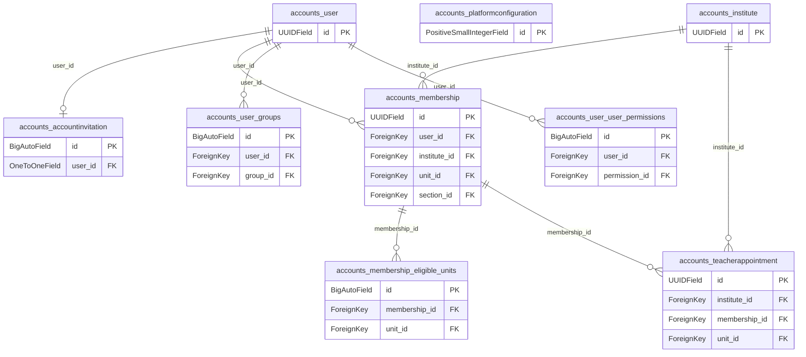
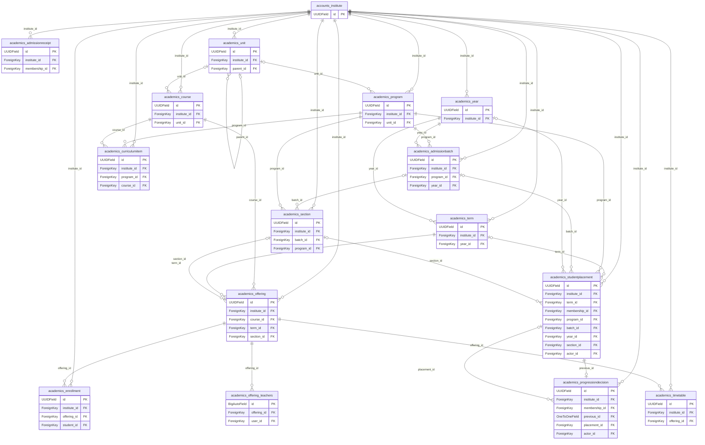
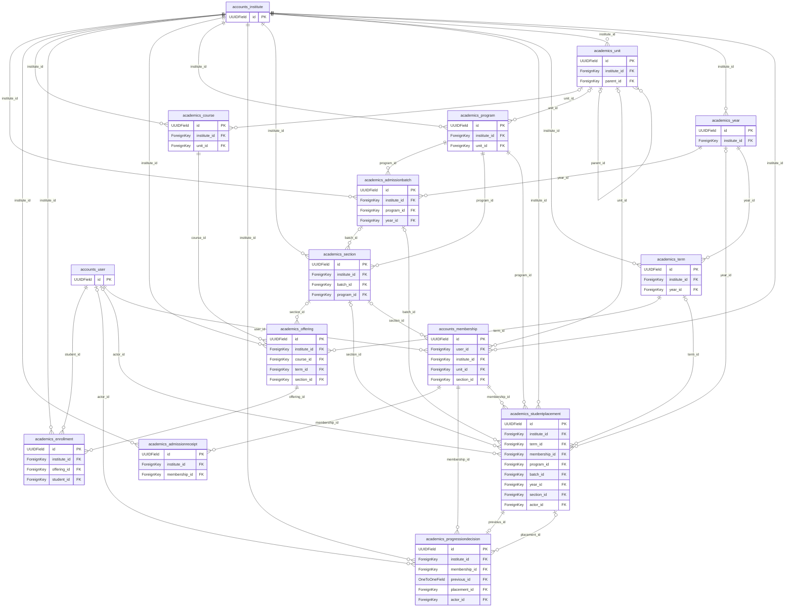
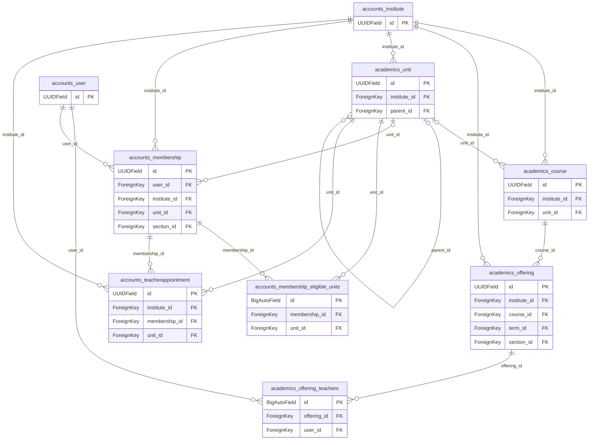
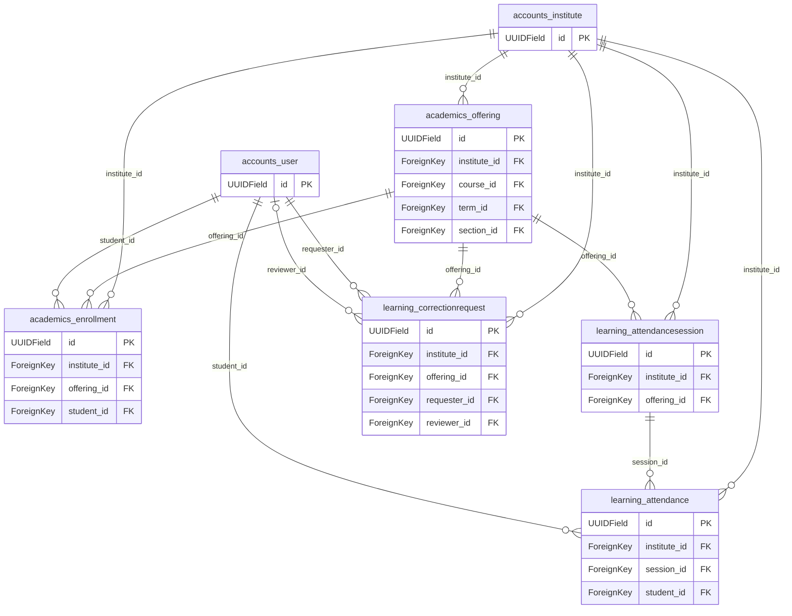
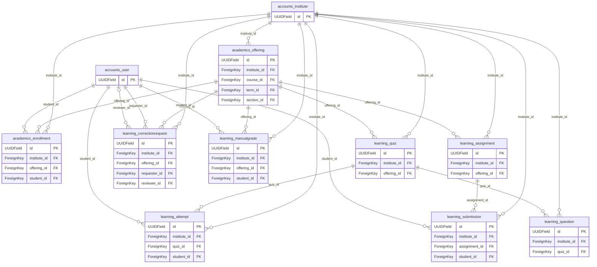
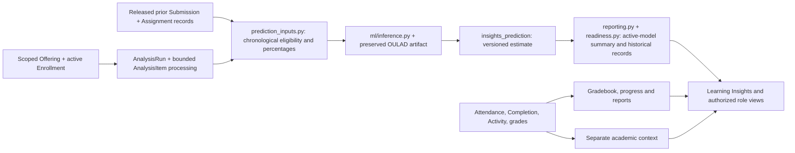

# Database relationships

Generated from actual foreign keys. Diagrams show PK/FK columns; the [dictionary](DATABASE_DICTIONARY.md) lists every column, type and constraint. Automatic join tables make many-to-many links explicit. Missing edges mean there is no database foreign key, even when a service uses an identifier.

A Course is a subject in the catalog; an Offering is its delivery in a period/group. A User is a global login; Membership is the user's role in one institute. Unit means department outside schools. Enrollment links a learner to an offering; StudentPlacement records class/program placement history.

`CorrectionRequest.target_id` and Audit.object_id are workflow identifiers, not invented foreign keys. Resolve them only through the existing scoped governance/audit code. Django deletion policies are ORM behavior; do not assume direct SQL has the same history protection.

## Complete database ER diagram

```mermaid
erDiagram
  academics_admissionbatch {
    UUIDField id PK
    ForeignKey institute_id FK
    ForeignKey program_id FK
    ForeignKey year_id FK
  }
  academics_admissionreceipt {
    UUIDField id PK
    ForeignKey institute_id FK
    ForeignKey membership_id FK
  }
  academics_course {
    UUIDField id PK
    ForeignKey institute_id FK
    ForeignKey unit_id FK
  }
  academics_curriculumitem {
    UUIDField id PK
    ForeignKey institute_id FK
    ForeignKey program_id FK
    ForeignKey course_id FK
  }
  academics_enrollment {
    UUIDField id PK
    ForeignKey institute_id FK
    ForeignKey offering_id FK
    ForeignKey student_id FK
  }
  academics_offering {
    UUIDField id PK
    ForeignKey institute_id FK
    ForeignKey course_id FK
    ForeignKey term_id FK
    ForeignKey section_id FK
  }
  academics_offering_teachers {
    BigAutoField id PK
    ForeignKey offering_id FK
    ForeignKey user_id FK
  }
  academics_program {
    UUIDField id PK
    ForeignKey institute_id FK
    ForeignKey unit_id FK
  }
  academics_progressiondecision {
    UUIDField id PK
    ForeignKey institute_id FK
    ForeignKey membership_id FK
    OneToOneField previous_id FK
    ForeignKey placement_id FK
    ForeignKey actor_id FK
  }
  academics_section {
    UUIDField id PK
    ForeignKey institute_id FK
    ForeignKey batch_id FK
    ForeignKey program_id FK
  }
  academics_studentplacement {
    UUIDField id PK
    ForeignKey institute_id FK
    ForeignKey term_id FK
    ForeignKey membership_id FK
    ForeignKey program_id FK
    ForeignKey batch_id FK
    ForeignKey year_id FK
    ForeignKey section_id FK
    ForeignKey actor_id FK
  }
  academics_term {
    UUIDField id PK
    ForeignKey institute_id FK
    ForeignKey year_id FK
  }
  academics_timetable {
    UUIDField id PK
    ForeignKey institute_id FK
    ForeignKey offering_id FK
  }
  academics_unit {
    UUIDField id PK
    ForeignKey institute_id FK
    ForeignKey parent_id FK
  }
  academics_year {
    UUIDField id PK
    ForeignKey institute_id FK
  }
  accounts_accountinvitation {
    BigAutoField id PK
    OneToOneField user_id FK
  }
  accounts_institute {
    UUIDField id PK
  }
  accounts_membership {
    UUIDField id PK
    ForeignKey user_id FK
    ForeignKey institute_id FK
    ForeignKey unit_id FK
    ForeignKey section_id FK
  }
  accounts_membership_eligible_units {
    BigAutoField id PK
    ForeignKey membership_id FK
    ForeignKey unit_id FK
  }
  accounts_platformconfiguration {
    PositiveSmallIntegerField id PK
  }
  accounts_teacherappointment {
    UUIDField id PK
    ForeignKey institute_id FK
    ForeignKey membership_id FK
    ForeignKey unit_id FK
  }
  accounts_user {
    UUIDField id PK
  }
  accounts_user_groups {
    BigAutoField id PK
    ForeignKey user_id FK
    ForeignKey group_id FK
  }
  accounts_user_user_permissions {
    BigAutoField id PK
    ForeignKey user_id FK
    ForeignKey permission_id FK
  }
  auth_group {
    AutoField id PK
  }
  auth_group_permissions {
    AutoField id PK
    ForeignKey group_id FK
    ForeignKey permission_id FK
  }
  auth_permission {
    AutoField id PK
    ForeignKey content_type_id FK
  }
  django_admin_log {
    AutoField id PK
    ForeignKey user_id FK
    ForeignKey content_type_id FK
  }
  django_content_type {
    AutoField id PK
  }
  django_migrations {
    BigAutoField id PK
  }
  django_session {
    CharField session_key PK
  }
  insights_activity {
    UUIDField id PK
    ForeignKey institute_id FK
    ForeignKey user_id FK
    ForeignKey offering_id FK
  }
  insights_analysisitem {
    UUIDField id PK
    ForeignKey institute_id FK
    ForeignKey run_id FK
    ForeignKey student_id FK
  }
  insights_analysisrun {
    UUIDField id PK
    ForeignKey institute_id FK
    ForeignKey offering_id FK
    ForeignKey requested_by_id FK
  }
  insights_audit {
    UUIDField id PK
    ForeignKey institute_id FK
    ForeignKey actor_id FK
  }
  insights_prediction {
    UUIDField id PK
    ForeignKey institute_id FK
    ForeignKey student_id FK
    ForeignKey offering_id FK
  }
  learning_announcement {
    UUIDField id PK
    ForeignKey institute_id FK
    ForeignKey unit_id FK
    ForeignKey offering_id FK
  }
  learning_assignment {
    UUIDField id PK
    ForeignKey institute_id FK
    ForeignKey offering_id FK
  }
  learning_attempt {
    UUIDField id PK
    ForeignKey institute_id FK
    ForeignKey quiz_id FK
    ForeignKey student_id FK
  }
  learning_attendance {
    UUIDField id PK
    ForeignKey institute_id FK
    ForeignKey session_id FK
    ForeignKey student_id FK
  }
  learning_attendancesession {
    UUIDField id PK
    ForeignKey institute_id FK
    ForeignKey offering_id FK
  }
  learning_bankquestion {
    UUIDField id PK
    ForeignKey institute_id FK
    ForeignKey author_id FK
    ForeignKey unit_id FK
  }
  learning_completion {
    UUIDField id PK
    ForeignKey institute_id FK
    ForeignKey lesson_id FK
    ForeignKey student_id FK
  }
  learning_correctionrequest {
    UUIDField id PK
    ForeignKey institute_id FK
    ForeignKey offering_id FK
    ForeignKey requester_id FK
    ForeignKey reviewer_id FK
  }
  learning_lesson {
    UUIDField id PK
    ForeignKey institute_id FK
    ForeignKey offering_id FK
    ForeignKey module_id FK
  }
  learning_manualgrade {
    UUIDField id PK
    ForeignKey institute_id FK
    ForeignKey offering_id FK
    ForeignKey student_id FK
  }
  learning_material {
    UUIDField id PK
    ForeignKey institute_id FK
    ForeignKey offering_id FK
    ForeignKey lesson_id FK
  }
  learning_module {
    UUIDField id PK
    ForeignKey institute_id FK
    ForeignKey offering_id FK
  }
  learning_notification {
    UUIDField id PK
    ForeignKey institute_id FK
    ForeignKey user_id FK
  }
  learning_question {
    UUIDField id PK
    ForeignKey institute_id FK
    ForeignKey quiz_id FK
  }
  learning_quiz {
    UUIDField id PK
    ForeignKey institute_id FK
    ForeignKey offering_id FK
  }
  learning_submission {
    UUIDField id PK
    ForeignKey institute_id FK
    ForeignKey assignment_id FK
    ForeignKey student_id FK
  }
  accounts_institute ||--o{ academics_admissionbatch : "institute_id"
  academics_program ||--o{ academics_admissionbatch : "program_id"
  academics_year ||--o{ academics_admissionbatch : "year_id"
  accounts_institute ||--o{ academics_admissionreceipt : "institute_id"
  accounts_membership ||--o{ academics_admissionreceipt : "membership_id"
  accounts_institute ||--o{ academics_course : "institute_id"
  academics_unit |o--o{ academics_course : "unit_id"
  accounts_institute ||--o{ academics_curriculumitem : "institute_id"
  academics_program ||--o{ academics_curriculumitem : "program_id"
  academics_course ||--o{ academics_curriculumitem : "course_id"
  accounts_institute ||--o{ academics_enrollment : "institute_id"
  academics_offering ||--o{ academics_enrollment : "offering_id"
  accounts_user ||--o{ academics_enrollment : "student_id"
  accounts_institute ||--o{ academics_offering : "institute_id"
  academics_course ||--o{ academics_offering : "course_id"
  academics_term ||--o{ academics_offering : "term_id"
  academics_section |o--o{ academics_offering : "section_id"
  academics_offering ||--o{ academics_offering_teachers : "offering_id"
  accounts_user ||--o{ academics_offering_teachers : "user_id"
  accounts_institute ||--o{ academics_program : "institute_id"
  academics_unit |o--o{ academics_program : "unit_id"
  accounts_institute ||--o{ academics_progressiondecision : "institute_id"
  accounts_membership ||--o{ academics_progressiondecision : "membership_id"
  academics_studentplacement ||--o| academics_progressiondecision : "previous_id"
  academics_studentplacement |o--o{ academics_progressiondecision : "placement_id"
  accounts_user |o--o{ academics_progressiondecision : "actor_id"
  accounts_institute ||--o{ academics_section : "institute_id"
  academics_admissionbatch |o--o{ academics_section : "batch_id"
  academics_program ||--o{ academics_section : "program_id"
  accounts_institute ||--o{ academics_studentplacement : "institute_id"
  academics_term |o--o{ academics_studentplacement : "term_id"
  accounts_membership ||--o{ academics_studentplacement : "membership_id"
  academics_program ||--o{ academics_studentplacement : "program_id"
  academics_admissionbatch |o--o{ academics_studentplacement : "batch_id"
  academics_year |o--o{ academics_studentplacement : "year_id"
  academics_section |o--o{ academics_studentplacement : "section_id"
  accounts_user |o--o{ academics_studentplacement : "actor_id"
  accounts_institute ||--o{ academics_term : "institute_id"
  academics_year ||--o{ academics_term : "year_id"
  accounts_institute ||--o{ academics_timetable : "institute_id"
  academics_offering ||--o{ academics_timetable : "offering_id"
  accounts_institute ||--o{ academics_unit : "institute_id"
  academics_unit |o--o{ academics_unit : "parent_id"
  accounts_institute ||--o{ academics_year : "institute_id"
  accounts_user ||--o| accounts_accountinvitation : "user_id"
  accounts_user ||--o{ accounts_membership : "user_id"
  accounts_institute ||--o{ accounts_membership : "institute_id"
  academics_unit |o--o{ accounts_membership : "unit_id"
  academics_section |o--o{ accounts_membership : "section_id"
  accounts_membership ||--o{ accounts_membership_eligible_units : "membership_id"
  academics_unit ||--o{ accounts_membership_eligible_units : "unit_id"
  accounts_institute ||--o{ accounts_teacherappointment : "institute_id"
  accounts_membership ||--o{ accounts_teacherappointment : "membership_id"
  academics_unit ||--o{ accounts_teacherappointment : "unit_id"
  accounts_user ||--o{ accounts_user_groups : "user_id"
  auth_group ||--o{ accounts_user_groups : "group_id"
  accounts_user ||--o{ accounts_user_user_permissions : "user_id"
  auth_permission ||--o{ accounts_user_user_permissions : "permission_id"
  auth_group ||--o{ auth_group_permissions : "group_id"
  auth_permission ||--o{ auth_group_permissions : "permission_id"
  django_content_type ||--o{ auth_permission : "content_type_id"
  accounts_user ||--o{ django_admin_log : "user_id"
  django_content_type |o--o{ django_admin_log : "content_type_id"
  accounts_institute ||--o{ insights_activity : "institute_id"
  accounts_user ||--o{ insights_activity : "user_id"
  academics_offering ||--o{ insights_activity : "offering_id"
  accounts_institute ||--o{ insights_analysisitem : "institute_id"
  insights_analysisrun ||--o{ insights_analysisitem : "run_id"
  accounts_user ||--o{ insights_analysisitem : "student_id"
  accounts_institute ||--o{ insights_analysisrun : "institute_id"
  academics_offering ||--o{ insights_analysisrun : "offering_id"
  accounts_user ||--o{ insights_analysisrun : "requested_by_id"
  accounts_institute ||--o{ insights_audit : "institute_id"
  accounts_user |o--o{ insights_audit : "actor_id"
  accounts_institute ||--o{ insights_prediction : "institute_id"
  accounts_user ||--o{ insights_prediction : "student_id"
  academics_offering ||--o{ insights_prediction : "offering_id"
  accounts_institute ||--o{ learning_announcement : "institute_id"
  academics_unit |o--o{ learning_announcement : "unit_id"
  academics_offering |o--o{ learning_announcement : "offering_id"
  accounts_institute ||--o{ learning_assignment : "institute_id"
  academics_offering ||--o{ learning_assignment : "offering_id"
  accounts_institute ||--o{ learning_attempt : "institute_id"
  learning_quiz ||--o{ learning_attempt : "quiz_id"
  accounts_user ||--o{ learning_attempt : "student_id"
  accounts_institute ||--o{ learning_attendance : "institute_id"
  learning_attendancesession ||--o{ learning_attendance : "session_id"
  accounts_user ||--o{ learning_attendance : "student_id"
  accounts_institute ||--o{ learning_attendancesession : "institute_id"
  academics_offering ||--o{ learning_attendancesession : "offering_id"
  accounts_institute ||--o{ learning_bankquestion : "institute_id"
  accounts_user ||--o{ learning_bankquestion : "author_id"
  academics_unit |o--o{ learning_bankquestion : "unit_id"
  accounts_institute ||--o{ learning_completion : "institute_id"
  learning_lesson ||--o{ learning_completion : "lesson_id"
  accounts_user ||--o{ learning_completion : "student_id"
  accounts_institute ||--o{ learning_correctionrequest : "institute_id"
  academics_offering ||--o{ learning_correctionrequest : "offering_id"
  accounts_user ||--o{ learning_correctionrequest : "requester_id"
  accounts_user |o--o{ learning_correctionrequest : "reviewer_id"
  accounts_institute ||--o{ learning_lesson : "institute_id"
  academics_offering ||--o{ learning_lesson : "offering_id"
  learning_module |o--o{ learning_lesson : "module_id"
  accounts_institute ||--o{ learning_manualgrade : "institute_id"
  academics_offering ||--o{ learning_manualgrade : "offering_id"
  accounts_user ||--o{ learning_manualgrade : "student_id"
  accounts_institute ||--o{ learning_material : "institute_id"
  academics_offering ||--o{ learning_material : "offering_id"
  learning_lesson ||--o{ learning_material : "lesson_id"
  accounts_institute ||--o{ learning_module : "institute_id"
  academics_offering ||--o{ learning_module : "offering_id"
  accounts_institute ||--o{ learning_notification : "institute_id"
  accounts_user ||--o{ learning_notification : "user_id"
  accounts_institute ||--o{ learning_question : "institute_id"
  learning_quiz ||--o{ learning_question : "quiz_id"
  accounts_institute ||--o{ learning_quiz : "institute_id"
  academics_offering ||--o{ learning_quiz : "offering_id"
  accounts_institute ||--o{ learning_submission : "institute_id"
  learning_assignment ||--o{ learning_submission : "assignment_id"
  accounts_user ||--o{ learning_submission : "student_id"
```

## Accounts and institutes

## Academic structure

## Student admission and enrollment

## Teaching assignments

## Attendance

## Assignments and grading

## Analytics and predictions data flow

This is a computation diagram, not additional database relationships. Attendance and activity provide academic context; they are not OULAD model inputs.

Prediction target: the next **submitted assignment** scoring below 40%. It is not final course failure, dropout or attendance prediction. See [ML guide](ANALYTICS_AND_ML.md).
