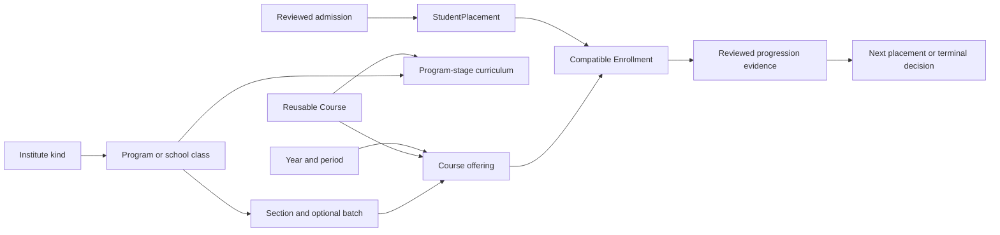
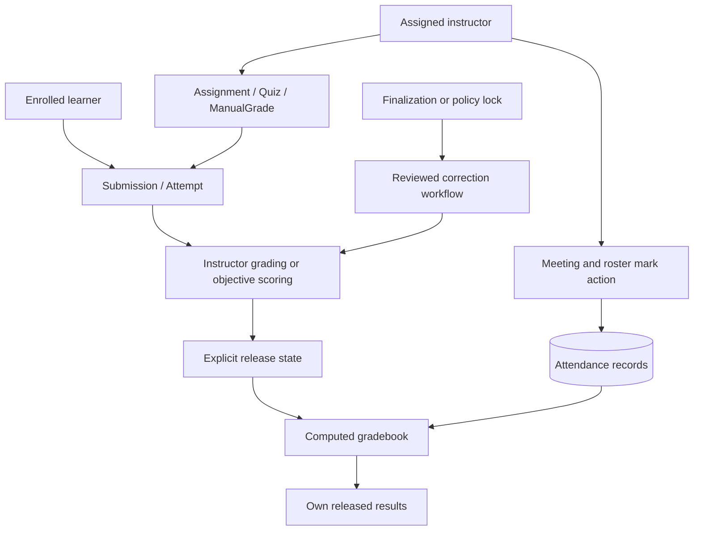

# End-to-end feature workflows

## Contents

- [Shared request mechanics](#shared-request-mechanics)
- [Institute and administrator creation](#institute-and-administrator-creation)
- [Admission and teacher provisioning](#admission-and-teacher-provisioning)
- [Academic structure and enrollment](#academic-structure-and-enrollment)
- [Attendance and assessment](#attendance-and-assessment)
- [Release and correction](#release-and-correction)
- [GPA and progression](#gpa-and-progression)
- [Reports and predictions](#reports-and-predictions)
- [Profile and security](#profile-and-security)

## Shared request mechanics

The paths below have `/api/v1/` as their API prefix. Frontend [api.ts](../frontend/src/lib/api.ts) adds session/CSRF credentials; [Auth.tsx](../frontend/src/features/auth/Auth.tsx) supplies identity and clears scoped caches on context changes. Every successful mutation returns JSON or 204; the caller refreshes/invalidates affected TanStack Query data or updates its own result state. Errors render through existing form/error components. Backend [Scope](../backend/apps/accounts/scope.py), validated related objects and specialized service checks remain authoritative even if a button is hidden.

## Institute and administrator creation

### 1. Create an institute

**Frontend:** `/institutes` → [ResourcePage/ResourceForm](../frontend/src/features/resources/ResourceForm.tsx), using `institutes` config. **Request:** `POST institutes/` with name, code, supported kind and active state. **Backend:** [InstituteViewSet.perform_create](../backend/apps/accounts/views.py) requires Super Admin; InstituteSerializer validates kind/configuration and unique code. **Database:** create Institute. This create method does not itself write an Audit row; do not assume every API operation is automatically audited. **Response/UI:** serialized institute; list invalidation shows the new tenant. No departments/users/courses are silently seeded by ordinary institute creation. Setup proceeds through institute administration. Related tests: [test_platform_accounts.py](../backend/tests/test_platform_accounts.py), [platform-settings.spec.ts](../frontend/e2e/platform-settings.spec.ts).

### 2. Create or attach an Institute Admin

**Frontend:** platform institute administrator controls/people form, or [LinkAccount](../frontend/src/features/resources/LinkAccount.tsx) for an existing identity. **Request:** `POST memberships/` for a new invited account; `POST memberships/attach/` to attach an existing authorized identity, explicitly targeting the institute. **Backend:** [MembershipViewSet.create/attach](../backend/apps/accounts/views.py), InvitationInput/AttachInput and MembershipSerializer permit Super Admin to create only administrator memberships. Target-related objects are validated against that institute even without a selected session institute. **Database:** User + Membership and invitation state, or only new Membership for attach; duplicate membership and privilege escalation are rejected. **Response/UI:** serialized member/transport state and refreshed administrator list. Invitation setup is completed through `/reset/:uid/:token`; do not return or store a plaintext password. [test_invitation_policy.py](../backend/tests/test_invitation_policy.py), [test_platform_accounts.py](../backend/tests/test_platform_accounts.py).

## Admission and teacher provisioning

### 3. Admit a student

**Frontend:** [StudentAdmission](../frontend/src/features/resources/StudentAdmission.tsx) collects identity, institute-specific placement and suggested offerings. **Requests:** `GET admissions/offerings/`; `POST admissions/` first with preview, then the same reviewed values/key for commit. **Validation/permission:** [admission.admin_scope/validate_placement/admit_student](../backend/apps/academics/admission.py) require Institute Admin, active same-tenant structures, compatible period/stage/course choices and unique identity/student identifier. **Database:** atomic User, Membership, StudentPlacement, Enrollment and AdmissionReceipt; receipt digest detects key reuse with different content. Audit/notification are recorded; invitation email is sent after commit. **Response/UI:** preview evidence or 201 saved membership, replay status and placement/offering summaries; page shows the saved result and related lists refresh. [test_admission.py](../backend/tests/test_admission.py), [zzz-admission.spec.ts](../frontend/e2e/zzz-admission.spec.ts).

### 4. Provision and appoint a teacher

**Frontend:** Admin provisions teacher identity/eligible units through people; Head opens [TeacherAppointments](../frontend/src/features/resources/TeacherAppointments.tsx). **Requests:** `POST memberships/` or authorized `PATCH memberships/{id}/`; Head `GET teacher-appointments/candidates/`, `POST teacher-appointments/`, then `PATCH offerings/{id}/` with `teachers`. **Backend:** account validation establishes eligibility; [TeacherAppointmentViewSet](../backend/apps/accounts/appointments.py) requires a Head's own unit and an active eligible teaching member. [OfferingViewSet](../backend/apps/academics/views.py)/TenantSerializer verify appointment/assignment scope; Head may change only teachers. **Database:** retained appointment row, offering M2M assignment, Audit and notifications. **Response/UI:** appointed member and updated lists; teacher sees the assigned course. School has no department appointment: Admin assigns directly. A college/university Admin override requires the recorded assignment reason. Removal/role changes use [StaffLifecycle](../frontend/src/features/resources/StaffLifecycle.tsx) → impact/transition/replace-head actions, preserving history and enforcing reassignment. [test_teacher_appointments.py](../backend/tests/test_teacher_appointments.py), [test_staff_lifecycle.py](../backend/tests/test_staff_lifecycle.py).

## Academic structure and enrollment

### 5. Create department, program, subject and offering

**Frontend:** [Academics](../frontend/src/features/resources/Academics.tsx) links resource forms. **Requests:** `POST units/`, `programs/`, `years/`, `terms/`, `sections/`, `courses/`, `curriculum/`, `offerings/` as needed. **Validation/permission:** [StructureViewSet/OfferingViewSet](../backend/apps/academics/views.py), [TenantSerializer](../backend/apps/academics/serializers.py) and [institution rules](../backend/apps/accounts/institution.py) require Admin management, matching tenant relationships, calendar bounds, correct annual/semester structure and assessment weights totaling 100. Schools omit Unit; Program is their class. **Database:** separate reusable Course and delivered Offering linked to Term/Section; curriculum maps subject to stage. **Response/UI:** serialized record with relation labels; query invalidation refreshes lists/selectors. Head's assignment-only update is not offering creation. [test_curriculum_setup.py](../backend/tests/test_curriculum_setup.py), [test_period_integrity.py](../backend/tests/test_period_integrity.py).

### 6. Enroll, withdraw or reactivate students

**Frontend:** [BulkEnrollment](../frontend/src/features/courses/BulkEnrollment.tsx) in an offering. **Requests:** `GET offerings/{id}/enrollment-candidates/`; `POST offerings/{id}/bulk-enrollment/` with up to 100 student **User IDs**, operation and reason. Candidate rows also contain Membership IDs; do not confuse them. **Backend:** [EnrollmentActions](../backend/apps/academics/enrollment.py) restricts Admin/Head to authorized offerings and active scoped students; [validate_enrollment](../backend/apps/academics/eligibility.py) verifies placement/curriculum/period compatibility. Institute lock and transaction prevent partial application. **Database:** create or update Enrollment.active; retain grades/attendance/history; record changes in Audit/Notification. **Response/UI:** changed/unchanged counts and refreshed roster. Direct enrollment CRUD is deliberately denied. [test_bulk_enrollment.py](../backend/tests/test_bulk_enrollment.py).

## Attendance and assessment

### 7. Record attendance

**Frontend:** create a meeting via attendance-sessions ResourceForm, then open [AttendanceRoster](../frontend/src/features/resources/AttendanceRoster.tsx). **Requests:** `POST attendance-sessions/`; paginated `GET attendance-sessions/{id}/roster/`; `POST attendance-sessions/{id}/mark/`. **Backend:** [AttendanceSessionViewSet](../backend/apps/learning/views.py) validates assignment to teach, open/unarchived offering, active learners, valid statuses and record lock/window policy; [roster_response](../backend/apps/learning/roster.py) joins saved rows onto the current roster. **Database:** meeting plus unique Attendance(session, student), audit of marking. **Response/UI:** saved counts/records, query refresh and retained per-page feedback. Unmarked students are not silently filled as present/absent. Admin/Head oversight reads the roster; ordinary marks require instructor assignment. [test_attendance_roster.py](../backend/tests/test_attendance_roster.py), [attendance.spec.ts](../frontend/e2e/attendance.spec.ts).

### 8. Create, submit and grade an assignment

**Frontend:** assigned teacher's ResourceForm creates Assignment; student opens [WorkflowDialog](../frontend/src/features/resources/WorkflowDialog.tsx); teacher opens submission grading. **Requests:** `POST assignments/`; optional authorized attachment download; `POST assignments/{id}/submit/` (text/file); `POST submissions/{id}/grade/` (marks/feedback/release). **Backend:** [AssignmentViewSet/SubmissionViewSet](../backend/apps/learning/views.py), strict contracts and `validate_upload` enforce instructor/student scope, publication/deadline/late/resubmit policy, file constraints and marks range. **Database:** Assignment, unique Submission, Activity/Audit and relevant notifications; resubmission follows explicit policy rather than creating duplicate records. **Response/UI:** updated submission/grade, refreshed lists/history; students see marks only when released. Finalized/released-protected work routes to corrections. [test_assessment_extras.py](../backend/tests/test_assessment_extras.py), [learning.spec.ts](../frontend/e2e/learning.spec.ts).

### 9. Create and complete a quiz

**Frontend:** teacher creates Quiz, uses [QuizAuthoring](../frontend/src/features/quizzes/QuizAuthoring.tsx) for individual/bulk/CSV/bank questions, ordering or draft duplication. Student starts from resource action and navigates to [QuizAttempt](../frontend/src/features/quizzes/QuizAttempt.tsx). **Requests:** quiz/question CRUD and authoring actions; `POST quizzes/{id}/start/`, `GET attempts/{id}/`, permitted questions, `POST attempts/{id}/save_answers/`, `POST attempts/{id}/submit/`. **Backend:** [QuizAuthoringActions](../backend/apps/learning/authoring.py), [QuizViewSet/QuestionViewSet/AttemptViewSet](../backend/apps/learning/views.py) enforce instructor assignment, valid window/limits, question locking after attempts, student's own attempt and server deadline. **Database:** ordered Question rows; Attempt with answers/deadline/submission state; `score_attempt` calculates objective marks; short-answer marks require instructor `grade/`. **Response/UI:** saved attempt/time/result state; release controls what learner sees. Max 500 questions per quiz; duplicating does not copy students' attempts. [test_quiz_authoring.py](../backend/tests/test_quiz_authoring.py), [test_postgres_concurrency.py](../backend/tests/test_postgres_concurrency.py), [QuizAttempt.test.tsx](../frontend/src/features/quizzes/QuizAttempt.test.tsx).

## Release and correction

### 10. Release grades

**Frontend:** submission grading dialog, quiz release field or manual-grade form. **Request:** submission `grade/` with released state; `PATCH quizzes/{id}/` released; ManualGrade create/update with released. **Backend:** instructor checks and [academic_lock_reason](../backend/apps/learning/policies.py) protect ordinary writes; release transition notifications are implemented in learning.views. **Database:** release state resides on Submission, Quiz and ManualGrade respectively; Attempt results follow Quiz.released. **Response/UI:** refreshed rows/reports; [gradebook](../backend/apps/insights/gradebook.py) recomputes released category averages and configured weights. Attendance/completion remain separate indicators, not extra grade weights. [test_stability_grading.py](../backend/tests/test_stability_grading.py), [test_notifications.py](../backend/tests/test_notifications.py).

### 11. Correct grades or attendance

**Frontend:** [AcademicControl](../frontend/src/features/resources/AcademicControl.tsx) fetches current snapshot/allowed actions; AcademicReviews shows the queue. **Requests:** `GET academic-control/?kind=...&target=...`; Admin `POST academic-control/finalize/`; requester `POST corrections/`; reviewer `POST corrections/{id}/decide/`; Admin emergency path `POST corrections/emergency/` with reason. **Backend:** [governance.py](../backend/apps/learning/governance.py) scopes target before retrieval, validates proposed fields/ranges, checks snapshot freshness, same-unit explicit Head delegation and independence. Assigned instructors may request; Admin may request or perform the explicitly audited emergency action. **Database:** CorrectionRequest original/proposed/decision, target changes only on valid approval/emergency, Audit and student notifications. **Response/UI:** updated status/control snapshot/history; unauthorized review and stale proposals fail visibly. [test_governance.py](../backend/tests/test_governance.py), [zzz-governance.spec.ts](../frontend/e2e/zzz-governance.spec.ts).

## GPA and progression

### 12. Calculate GPA/CGPA

**Frontend:** Admin enables university GPA policy/bands in [InstituteSettings](../frontend/src/features/auth/InstituteSettings.tsx); [AcademicResults](../frontend/src/features/analytics/AcademicResults.tsx) appears in student history/Admin placement. **Requests:** institute PATCH, then `GET academic-results/` (Student self) or `GET memberships/{id}/academic-results/` (Admin). **Backend:** [configuration.validate_grading_rules](../backend/apps/accounts/configuration.py) validates policy; [student_results/academic_results/weighted](../backend/apps/insights/academic_results.py) identify program and released grade points/credits, apply all/latest/best repeated-course policy and compute period GPA/program CGPA. **Database:** reads existing records; no GPA table write. **Response/UI:** status, policy, periods/programs and explicit excluded records. At most 1,000 enrollments; current credits/policies mean provisional results, not immutable transcripts. [test_academic_results.py](../backend/tests/test_academic_results.py).

### 13. Promote, repeat, transfer or finish a student placement

**Frontend:** Admin [StudentPlacement](../frontend/src/features/resources/StudentAdmission.tsx) and [StudentProgression](../frontend/src/features/resources/StudentProgression.tsx). **Requests:** transfer action for a reviewed placement transfer; progression `POST memberships/{id}/progress/` preview, then commit with expected placement, evidence token, reason and confirm_review. **Backend:** [transfer_student](../backend/apps/academics/admission.py), [result_evidence/progress_student](../backend/apps/academics/progression.py), eligibility helpers enforce active scoped membership, nonoverlapping academic periods, correct stage/class progression and retained-enrollment conflicts. Human review is required; optional all_required_pass policy checks released required curriculum results. **Database:** end old placement, create new where appropriate, retain/withdraw/reactivate enrollments according to operation, capture ProgressionDecision and audit/notification. **Response/UI:** new placement/decision IDs, refreshed student record and retained history. Withdrawal/completion/graduation end current enrollment access while released historical results remain readable. ML never decides progression. [test_progression.py](../backend/tests/test_progression.py), [completion-fresh-institute.spec.ts](../frontend/e2e/completion-fresh-institute.spec.ts).

## Reports and predictions

### 14. Generate/filter reports

**Frontend:** [Gradebook](../frontend/src/features/analytics/Gradebook.tsx), [Trends](../frontend/src/features/analytics/Trends.tsx), Workload and CourseComparisons use shared [ReportControls](../frontend/src/components/ReportControls.tsx). **Requests:** grades, analytics/trends, analytics/courses, analytics/workload and reports CSV with allowed query filters. **Backend:** [filters.py](../backend/apps/insights/filters.py) validates IDs/stage/page and obtains scoped offering/enrollment pairs before aggregation; [reporting.py](../backend/apps/insights/reporting.py), [course_reports.py](../backend/apps/insights/course_reports.py), [workload.py](../backend/apps/insights/workload.py) calculate their specific metrics. **Database:** scoped reads/SQL aggregates, gradebook in bounded batches. **Response/UI:** paginated JSON or streaming CSV; filters update URL/query keys and reset pages. CSV does not create a persisted report model. Unknown legacy stages are not inferred. [test_report_pagination.py](../backend/tests/test_report_pagination.py), [test_course_comparisons.py](../backend/tests/test_course_comparisons.py), [reporting.spec.ts](../frontend/e2e/reporting.spec.ts).

### 15. Run individual or class predictions

**Frontend:** teacher opens course AI insights/[Predictions](../frontend/src/features/analytics/Predictions.tsx), selects learner or Analyze Class. **Requests:** model-status GET; predictions POST or class-analysis POST followed by bounded `/{id}/advance/`, detail and items GET. **Backend:** [require_prediction_instructor](../backend/apps/insights/views.py), [batch.py](../backend/apps/insights/batch.py), [prediction_inputs.py](../backend/apps/insights/prediction_inputs.py) revalidate active tenant/assignment and compatible released observations; [inference.py](../backend/ml/inference.py) verifies trusted schema/hash and evaluates. **Database:** Prediction with immutable-by-API provenance; AnalysisRun/AnalysisItem state and input deduplication; existing synthetic history unchanged. **Response/UI:** ready probability/category or insufficient/unavailable detail, actual academic indicators, source/target/date/limitations and reloaded history. This is the conditional next-submitted-assignment-below-40% model, not course failure. [test_public_model.py](../backend/tests/test_public_model.py), [real-data-ml.spec.ts](../frontend/e2e/real-data-ml.spec.ts).

## Profile and security

### 16. Change profile, picture, notification preference or password

**Frontend:** [Profile](../frontend/src/features/auth/Profile.tsx), [ProfilePicture](../frontend/src/features/auth/ProfilePicture.tsx). **Requests:** `PATCH auth/me/` for first_name/last_name/notify_academic; `PUT`/`DELETE auth/avatar/` for picture; `POST auth/password-change/` with current/new password. **Backend:** [ProfileInput](../backend/apps/accounts/contracts.py) deliberately excludes role/tenant/email mutation; [profile.py](../backend/apps/accounts/profile.py) decodes/normalizes permitted images and serves them privately; [auth.password_change](../backend/apps/accounts/auth.py) checks current password and Django validators. **Database:** own User fields/file; password hash and session handling; no Membership privilege change. **Response/UI:** refreshed auth/profile/avatar or success/error message; notification preference influences internal notify_event. [test_profile_images.py](../backend/tests/test_profile_images.py), [test_auth_and_inference.py](../backend/tests/test_auth_and_inference.py).

For institute switching, Shell → AuthProvider.select → `auth/select-institute/` → active permitted membership check → session institute/workspace reset → returned identity and scoped query-cache replacement. This prevents the previous institute's cached records remaining visible after a switch.
