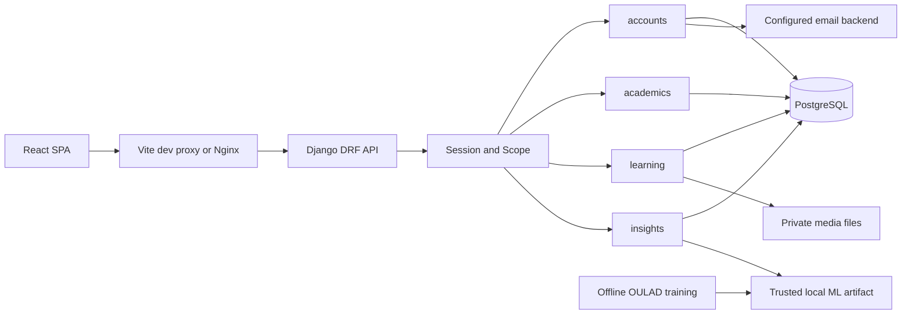

# IntelliLMS project codebase map

## Contents

- [Overview and stack](#overview-and-stack)
- [Repository layout](#repository-layout)
- [System architecture](#system-architecture)
- [Frontend architecture](#frontend-architecture)
- [Backend and database architecture](#backend-and-database-architecture)
- [Request and permission flow](#request-and-permission-flow)
- [ML and testing](#ml-and-testing)
- [Configuration and development](#configuration-and-development)
- [Detailed navigation](#detailed-navigation)

## Overview and stack

IntelliLMS is one multi-institute application. Each institute has its own academic structure and memberships; a person can belong to multiple institutes. The session selects the active institute. Department Heads have separate management and teaching workspaces. Most academic screens are shared components whose data and permitted actions depend on the current scope.

| Layer | Actual implementation / authority |
|---|---|
| SPA | React 19, TypeScript, React Router 7, TanStack Query 5, Vite 8; [package.json](../frontend/package.json), [package-lock.json](../frontend/package-lock.json) |
| UI/forms | Tailwind CSS 4, custom styles, Radix Dialog, Lucide icons, React Hook Form/Zod; [styles.css](../frontend/src/styles.css) |
| API | Django 5.2, Django REST Framework, django-filter, drf-spectacular; [requirements.lock.txt](../backend/requirements.lock.txt) |
| Database | PostgreSQL 17 in Compose; explicit SQLite only for development/browser fixtures |
| ML | pandas, NumPy, scikit-learn, joblib and Matplotlib in the locked Python environment |
| Tests | pytest/pytest-django, Vitest/Testing Library/jsdom, Playwright Chromium |
| Deployment | Gunicorn WSGI, Nginx SPA/TLS proxy, Docker Compose; no Celery/Redis service configured |

Dependency manifests specify ranges in places; lockfiles define reproducible installed versions. Do not assume manifest ranges are exact installed package versions.

## Repository layout

```text
AGENTS.md                         engineering rules
README.md                         setup and current verified checkpoint
IMPLEMENTATION_PROGRESS.md        chronological implementation evidence
.env.example                      environment variable template, not live secrets
.github/workflows/tests.yml       backend/frontend/browser CI jobs
backend/
  manage.py                       Django command entry
  config/                         settings, URLs, WSGI, readiness, E2E settings/mail
  apps/accounts/                  identity, tenancy, invitations, staff lifecycle
  apps/academics/                 structures, offerings, admissions, progression
  apps/learning/                  content, assessments, attendance, corrections
  apps/insights/                  gradebook, reports, GPA, prediction integration
  ml/                             training, OULAD preparation, trusted inference
    artifacts/                    active metadata and versioned model outputs
    data/oulad/                   ignored downloaded public training data
  tests/                          backend unit/API/security/concurrency tests
frontend/
  src/main.tsx                    providers and all React route registrations
  src/components/                 shell, selectors, feedback, dialogs, report controls
  src/features/                   auth, resources, courses, quizzes, analytics
  src/lib/                        API, scope display, terminology, URL filters
  e2e/                            browser workflows and helpers
  scripts/                        local preview helpers
scripts/                          setup, launch, isolated verification helpers
deployment/                       Nginx, frontend image, production env template
docker-compose.yml                local PostgreSQL service
docker-compose.production.yml     PostgreSQL + Gunicorn + Nginx
docs/                             handbook, requirements, evidence and operations
```

Generated/local directories such as `.venv`, `node_modules`, `frontend/dist`, private media, database files, logs and `backend/test-results` are not source modules. Do not commit their sensitive contents. The older [backend/schema.yml](../backend/schema.yml) and [backend/openapi.yaml](../backend/openapi.yaml) coexist with [docs/openapi.yaml](openapi.yaml); use current URL registrations and the current documented schema rather than assuming every saved schema is synchronized.

## System architecture



Private media is downloaded through authorized API actions. It is not a public `/media/` static directory. Training consumes downloaded public data; live academic records are not sent to that dataset host.

## Frontend architecture

[main.tsx](../frontend/src/main.tsx) mounts React, a QueryClient, BrowserRouter, AuthProvider and route-level Suspense. `WorkspaceHome` chooses `Platform` for Super Admin and `Dashboard` for institute users. `Dashboard` renders Admin/Head/Teacher/Student variants. The Gradebook import in main points to a re-export from Dashboard; its implementation lives in [Gradebook.tsx](../frontend/src/features/analytics/Gradebook.tsx).

[Auth.tsx](../frontend/src/features/auth/Auth.tsx) fetches CSRF and identity, derives the effective role and clears non-auth query caches when institute/workspace changes. [Shell.tsx](../frontend/src/components/layouts/Shell.tsx) owns navigation, institute switching, responsive menus and the workspace outlet. [WorkspaceRoute.tsx](../frontend/src/components/layouts/WorkspaceRoute.tsx) and [access.ts](../frontend/src/lib/access.ts) provide UI access checks; server checks remain authoritative.

[ResourcePage.tsx](../frontend/src/features/resources/ResourcePage.tsx) drives 30 resource pages from [config.ts](../frontend/src/features/resources/config.ts). It composes ResourceForm, ResourceFilters, workflow dialogs, cards and pagination. Special journeys such as admissions, appointment management and progression have dedicated components. [CourseDetail.tsx](../frontend/src/features/courses/CourseDetail.tsx) reuses these screens as local-state tabs with an offering filter; the tabs are not separate URL routes.

## Backend and database architecture

| App | Primary responsibilities | Start here |
|---|---|---|
| accounts | Users, institutes, membership scope, session login, invitations, avatars, appointments and lifecycle | [scope.py](../backend/apps/accounts/scope.py), [views.py](../backend/apps/accounts/views.py) |
| academics | Departments, years, periods, programs/classes, subjects, offerings, enrollment and placement/history | [models.py](../backend/apps/academics/models.py), [views.py](../backend/apps/academics/views.py), [admission.py](../backend/apps/academics/admission.py), [progression.py](../backend/apps/academics/progression.py) |
| learning | Lessons/materials, assignment submissions, quiz attempts, attendance, notifications and reviewed corrections | [views.py](../backend/apps/learning/views.py), [governance.py](../backend/apps/learning/governance.py) |
| insights | Computed gradebook/reports/GPA, activity/audit records, prediction history and bounded class analysis | [gradebook.py](../backend/apps/insights/gradebook.py), [views.py](../backend/apps/insights/views.py), [batch.py](../backend/apps/insights/batch.py) |

All app API registration is centralized in [config/urls.py](../backend/config/urls.py). There are no app-specific `urls.py` files. `TenantModel` supplies UUID, institute FK and creation time; it does not automatically filter ORM queries. `TenantViewSet`, `Scope`, serializers and individual services perform that enforcement. Settings/GPA policies use JSON on `Institute`, not a separate settings/GPA table. Gradebook and GPA are computed from records; progression evidence is persisted separately.

## Request and permission flow

```mermaid
sequenceDiagram
  participant UI as Feature component
  participant Q as TanStack Query / api.ts
  participant API as DRF endpoint
  participant S as Scope + serializer/service
  participant DB as PostgreSQL
  UI->>Q: Query or mutation
  Q->>API: /api/v1/ with session cookie and CSRF header
  API->>S: Authenticate; derive active institute/effective role
  S->>DB: Scoped lookup; validate related records
  S->>DB: Transactional write or authorized read
  API-->>Q: JSON page/result or structured error
  Q-->>UI: Render result; invalidate affected queries
```

Important exceptions: login/reset/public platform branding do not require an institute; Super Admin platform operations are global. A student's historical released results have a dedicated history API because their former enrollment may no longer grant course access. See the permission guide before reusing any broad queryset.

## ML and testing

The active public-data model predicts **next submitted assignment score below 40%**, using two preceding assignment percentages. [train.py](../backend/ml/train.py) selects and saves the model; [inference.py](../backend/ml/inference.py) verifies the trusted artifact; [prediction_inputs.py](../backend/apps/insights/prediction_inputs.py) reads compatible released LMS observations. Batches advance through HTTP requests, not a background worker. Historical synthetic versions retain their labels.

Backend tests live in [backend/tests](../backend/tests); frontend tests are colocated under [src](../frontend/src); browser workflows live in [frontend/e2e](../frontend/e2e). The last executed full checkpoint was 189 PostgreSQL, 59 frontend and 50 Chromium passes. This handbook task did not rerun those suites or reseed fixtures.

## Configuration and development

Read [config/settings.py](../backend/config/settings.py), [vite.config.ts](../frontend/vite.config.ts), [docker-compose.yml](../docker-compose.yml), [production Compose](../docker-compose.production.yml) and the [testing/debugging guide](TESTING_AND_DEBUGGING_GUIDE.md). The root `.env` is private local configuration: names are documented, values are not copied into this handbook. Shell environment variables override the dotenv-loaded defaults.

Other build entry points: [manage.py](../backend/manage.py), [wsgi.py](../backend/config/wsgi.py), [frontend/index.html](../frontend/index.html), [tsconfig.json](../frontend/tsconfig.json) (strict, noEmit, source/Vite configuration), [components.json](../frontend/components.json) (UI tooling), [requirements.txt](../backend/requirements.txt), [requirements-dev.txt](../backend/requirements-dev.txt), [.gitignore](../.gitignore) and [.dockerignore](../.dockerignore). Inspect the lockfiles when diagnosing dependency drift. `__init__.py` package markers and generated cache directories do not contain additional feature workflows.

## Detailed navigation

[Frontend pages](FRONTEND_PAGE_MAP.md) · [Backend/API](BACKEND_CODE_MAP.md) · [Database](DATABASE_CODE_MAP.md) · [Roles](ROLES_AND_PERMISSIONS_MAP.md) · [ML](AI_ML_CODE_MAP.md) · [Where to edit](WHERE_TO_EDIT.md) · [Workflows](FEATURE_WORKFLOWS.md) · [Testing/debugging](TESTING_AND_DEBUGGING_GUIDE.md) · [Handbook index](README.md).
