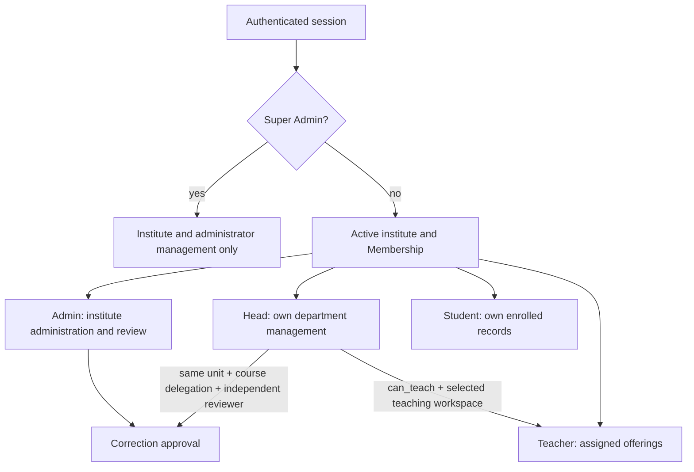

# Roles, permissions and institution rules

## Contents

- [Authorization layers](#authorization-layers)
- [Five-role matrix](#five-role-matrix)
- [Exact enforcement and tests](#exact-enforcement-and-tests)
- [Institution differences](#institution-differences)
- [Permission flow](#permission-flow)
- [Discrepancies and boundaries](#discrepancies-and-boundaries)

## Authorization layers

1. [settings.py](../backend/config/settings.py): DRF `SessionAuthentication` and default `IsAuthenticated`, Django sessions/CSRF, secure production cookies. Login/reset are explicit exceptions; login is separately CSRF-protected and throttled.
2. [Scope](../backend/apps/accounts/scope.py): reads `request.session['institute_id']`, checks an active institute and active Membership; caches scope only on the request. `offerings()` limits Admin to institute, Head to course unit, Teacher to current teaching assignments, Student to active enrollments. Super Admin is explicitly denied academic offering access.
3. [TenantViewSet](../backend/apps/academics/views/base.py): filters institute before object retrieval, optionally filters by offering path, rejects platform use of institutional resources (except own notifications), and protects relationships/history on updates/deletes.
4. [TenantSerializer](../backend/apps/academics/serializers.py) and [LearningSerializer](../backend/apps/learning/serializers.py): validate related objects, tenant/course membership, calendar, assignment and grading rules. A client-supplied UUID is not authorization.
5. Workflow-specific enforcement below. UI route visibility is a convenience, never the security boundary.

`Scope.require()` has a Super Admin bypass. Therefore it must not be used alone to prove denial of platform accounts: inspect the explicit platform guard, `Scope.offerings()`, scoped queryset and workflow-specific conditions too.

## Five-role matrix

| Role | Administrative reach | Academic actions | Explicit limits |
|---|---|---|---|
| Super Admin | Global institute CRUD, administrative account controls, Institute Admin memberships, platform configuration/audit and aggregates | Model status and platform aggregates; no routine student/teacher records or teaching | `User.is_superuser`, not a fifth Membership.role value. Target institute may be explicit for administrator provisioning; does not need an active institute for global pages. |
| Institute Admin | Own institute structure, people provisioning/eligibility, admissions/placement, curriculum, offering details, enrollment, timetable, settings | Read marks/attendance/reporting, finalize records, request/review independent corrections, reasoned emergency correction, progression | Cannot provision/promote Institute Admins; cannot perform ordinary instructor marking/content authoring; cannot run ML estimates merely through oversight. |
| Department Head, department workspace | Own unit roster and academic oversight; appoint eligible teachers; change own-unit offering teachers; bulk enrollment | UI exposes delegated correction review, own-unit reports and prediction inspection; learning APIs also retain the assigned, teaching-enabled Head case described below | Cannot create offerings or change their academic details; cannot review own correction; no other-unit management through a teaching assignment. |
| Teacher; Head in teaching workspace | Personally assigned offerings and enrolled learners | Content, assignments, quizzes, attendance, release/mark grades, question bank, individual/class ML | Active capability/appointment rules apply; closed/archived/finalized/locked records block ordinary writes; cannot edit another teacher's class. |
| Student | Own account and current enrolled offerings | Read released/published content and own grades, submit work, take own quiz attempts, complete lessons, view own history/progress | No answer keys before authorized release, classmates' marks, ML risk directory, staff authoring or tenant switching without membership. |

## Exact enforcement and tests

All test links here are existing source tests, not claims of tests executed during handbook writing.

| Rule | Actual implementation | Relevant tests |
|---|---|---|
| Platform/institute separation | `Scope.offerings`, `TenantViewSet.initial`; `MembershipViewSet.get_queryset/create`; `PlatformAdministrator`, `PlatformUserViewSet` in [platform.py](../backend/apps/accounts/platform.py); [InstituteViewSet](../backend/apps/accounts/views/institutes.py) | [test_platform_separation.py](../backend/tests/test_platform_separation.py), [test_platform_accounts.py](../backend/tests/test_platform_accounts.py), [test_platform_audit.py](../backend/tests/test_platform_audit.py) |
| Active tenant and membership | `Scope.__init__`, `offerings`, `people`, `check_offering`; [auth.select_institute](../backend/apps/accounts/auth.py) | [test_security.py](../backend/tests/test_security.py), [test_workflows.py](../backend/tests/test_workflows.py), [test_auth_and_inference.py](../backend/tests/test_auth_and_inference.py) |
| Head teaching workspace | `auth.select_workspace`; `Scope.__init__` maps Head to effective Teacher only with `can_teach`; `teaching_offerings` excludes withdrawn appointments | [test_teaching_workspace.py](../backend/tests/test_teaching_workspace.py), [completion-head.spec.ts](../frontend/e2e/completion-head.spec.ts), [test_public_model.py](../backend/tests/test_public_model.py) |
| Ordinary assessment/content writes | [learning/views package](../backend/apps/learning/views/__init__.py): `require_assigned_instructor`, `LearningViewSet.require_teaching_write`, Submission/Attempt grading, AttendanceSession.mark | [test_stability_authorization.py](../backend/tests/test_stability_authorization.py), [test_assessment_extras.py](../backend/tests/test_assessment_extras.py), [test_attendance_roster.py](../backend/tests/test_attendance_roster.py) |
| Teacher appointment ownership | [TeacherAppointmentViewSet.scope/create/withdraw](../backend/apps/accounts/appointments.py): Head writes own unit; Admin reads/provisions eligibility; active courses must be reassigned before withdrawal | [test_teacher_appointments.py](../backend/tests/test_teacher_appointments.py), [appointment-dropdown.spec.ts](../frontend/e2e/appointment-dropdown.spec.ts) |
| Course assignment ownership | `OfferingViewSet.create/update/audit_assignments` and teacher relationship validation in [academics serializers](../backend/apps/academics/serializers.py) | [test_teaching_assignments.py](../backend/tests/test_teaching_assignments.py), [test_staff_lifecycle.py](../backend/tests/test_staff_lifecycle.py) |
| Head correction delegation | [governance.reviewer](../backend/apps/learning/governance.py): requires effective role Head, matching unit and `Offering.head_correction_review`; `can_review_request` also forbids reviewing own request | [test_governance.py](../backend/tests/test_governance.py), [test_stability_authorization.py](../backend/tests/test_stability_authorization.py), [completion-policy-report.spec.ts](../frontend/e2e/completion-policy-report.spec.ts) |
| Finalization and emergency correction | `record_control`, `finalize_record`, `CorrectionViewSet.emergency/decide`; snapshots, reasons, stale-state checks, audit and notifications; [policies.academic_lock_reason](../backend/apps/learning/policies.py) | [test_academic_policies.py](../backend/tests/test_academic_policies.py), [test_governance.py](../backend/tests/test_governance.py) |
| Role removal / privileged transitions | [lifecycle.authorize/check_last_admin/reassign/transition/replace_head](../backend/apps/accounts/lifecycle.py); ordinary membership updates cannot bypass this | [test_staff_lifecycle.py](../backend/tests/test_staff_lifecycle.py), [test_account_contracts.py](../backend/tests/test_account_contracts.py) |
| Admissions and progression | [admission.admin_scope](../backend/apps/academics/admission.py), `validate_placement`; [progress_student](../backend/apps/academics/progression.py), [eligibility helpers](../backend/apps/academics/eligibility.py) | [test_admission.py](../backend/tests/test_admission.py), [test_progression.py](../backend/tests/test_progression.py), [test_period_integrity.py](../backend/tests/test_period_integrity.py) |
| Own released results/history | Learning serializers/querysets; [gradebook](../backend/apps/insights/gradebook.py); `AcademicHistory`, `ProgressionHistory`; [student_results](../backend/apps/insights/academic_results.py) | [test_stability_grading.py](../backend/tests/test_stability_grading.py), [test_learner_progress.py](../backend/tests/test_learner_progress.py), [test_academic_results.py](../backend/tests/test_academic_results.py) |
| Private files and profile images | `validate_upload`, scoped download actions; [profile.normalized_image/avatar/avatar_response](../backend/apps/accounts/profile.py); own or authorized membership avatar | [test_profile_images.py](../backend/tests/test_profile_images.py), [test_security_audit.py](../backend/tests/test_security_audit.py) |
| Predictions | [require_prediction_instructor/predictions](../backend/apps/insights/views/__init__.py), [batch authorized/scoped_run/start_analysis/advance_analysis](../backend/apps/insights/batch.py); recheck current assignment each advancement | [test_public_model.py](../backend/tests/test_public_model.py), [test_class_analysis.py](../backend/tests/test_class_analysis.py) |

## Institution differences

[institution.academic_config/require_departments/validate_structure](../backend/apps/accounts/institution.py) is the backend policy entry point. [useInstitution](../frontend/src/lib/institution.ts), [terminology.ts](../frontend/src/lib/terminology.ts), [ResourceForm](../frontend/src/features/resources/ResourceForm.tsx), [ReportControls](../frontend/src/components/ReportControls.tsx) and admissions/setup adapt the UI.

| Rule | School | College | University |
|---|---|---|---|
| Departments / Head | API and UI deny departments/Head workflows | Supported | Supported |
| Default program structure | Annual, each class lasts one year | Annual, default two study years, configurable duration | Semester, default eight semesters, configurable duration |
| Teacher assignment | Admin direct assignment | Head appointment/assignment; reasoned Admin override | Head appointment/assignment; reasoned Admin override |
| Student grouping | Program represents class; Section divides class | Program/stream, study year, Section | Program, admission batch, Section, semester |
| Progression | Move to different class in later year; stage remains 1 | Next study year in later academic year | Next stage in later nonoverlapping semester |
| GPA/CGPA | Not provided | Not provided | Explicit opt-in policy; released credit-weighted results; all/latest/best repeat handling |
| Correction review | Admin | Admin or explicitly delegated own-unit Head | Admin or explicitly delegated own-unit Head |

Old `kind='other'` and blank period types remain legacy records; creating a new institute requires one of the three supported kinds. Existing ambiguous history is not silently converted. [test_institution_rules.py](../backend/tests/test_institution_rules.py), [test_period_integrity.py](../backend/tests/test_period_integrity.py), [architecture-school.spec.ts](../frontend/e2e/architecture-school.spec.ts) and [completion-fresh-institute.spec.ts](../frontend/e2e/completion-fresh-institute.spec.ts) cover the distinctions.

## Permission flow

This is a scope/capability diagram, not inheritance: a higher administrative role does not automatically inherit teaching or student powers.

The teaching-workspace switch is the intended UI path. Actual learning API helpers also retain an assigned, teaching-enabled Head case described below; do not claim that every backend teaching action requires the effective role to be exactly Teacher. Public-model generation does enforce that stricter workspace rule.

## Discrepancies and boundaries

- **Static error-path finding:** `TeacherAppointmentViewSet.scope()` calls `require_departments(scope.institute)` before its explicit role check. A Super Admin without a selected institute can have `scope.institute is None`; `academic_config()` dereferences `.kind`. This appears capable of producing an AttributeError instead of a clean permission response on a direct appointment API request. It was found by source inspection, not reproduced against live data during this documentation task; no code was changed.
- **College batch discrepancy:** `academic_config()` and the UI say `batches=False` for colleges, but backend batch rejection in `TenantViewSet.initial` / `validate_structure` is school-specific. College batch APIs are therefore not categorically disabled in the same way as schools. Document this as UI/backend policy drift, not a claim that colleges require batches.
- **Audit coverage boundary:** `InstituteViewSet.perform_create()` saves the institute without creating an Audit or LogEntry row. Its update path does create an institutional Audit. Do not describe all institute API operations as automatically audited; a broader audit-completeness requirement would need a separate implementation/test change.
- **Head workspace enforcement differs by API:** `learning.views.require_assigned_instructor()` accepts Head or Teacher; `governance.assigned_instructor()` accepts a Head with `can_teach` and a personal assignment. Combined with department scope, an assigned teaching-enabled Head can therefore satisfy these helpers for their own unit while still in management workspace. The UI hides ordinary teaching controls there, and ML `require_prediction_instructor()` requires effective Teacher explicitly. This is a source-level distinction, not permission to teach outside the authorized assignment; a strict workspace-only API policy would need a separate change and tests.
- Shared frontend resource `write` arrays and broad backend `write_roles` include legacy-looking administrative entries. `ResourcePage` teaching restrictions, `LearningViewSet.require_teaching_write` and instructor checks narrow actual powers. Do not copy an array and treat it as the complete authorization rule.
- Ordinary `routeAllowed` defaults allow some non-menu resource routes to reach the server; resource visibility does not grant backend data access. Not every frontend resource has a dedicated sidebar link.
- Earlier history documents mention automatic Head review. Current code and current architecture requirements require explicit offering delegation. This handbook describes that current rule.
- GPA is computed using current policy/credits, not an immutable official transcript. Public-data ML is experimental and not locally validated. Existing SMTP/TLS/off-host recovery and accessibility/load limitations remain in [limitations.md](limitations.md).
