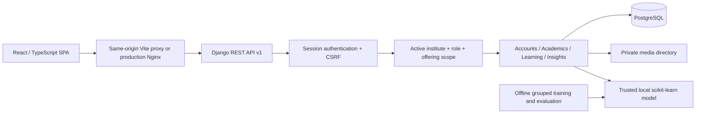

# System architecture

React Router owns pages; TanStack Query owns server state; React Hook Form and Zod validate record forms. Session credentials remain in HTTP-only cookies. The SPA obtains a separate CSRF cookie and sends `X-CSRFToken` on mutations.

`Scope` derives membership from the session, never a client-supplied role. It scopes offerings by institute, department, instructor assignment, or student enrollment. Viewsets narrow querysets before object retrieval. Serializer validation checks related tenant ownership; relationship movement after creation is blocked.

Workflow endpoints execute submissions, marking, and attempts transactionally. PostgreSQL row locks serialize concurrent assignment submissions, quiz starts, grade updates, and attendance writes. SQLite is useful for smoke tests but does not provide equivalent row-lock semantics.

A course definition is distinct from an offering. A lesson/module belongs to an offering; an assessment and all resulting student records inherit that ownership. Analytics aggregate only authorized offerings. Prediction inference builds features from real stored observations and persists model/version metadata.

Production Nginx terminates TLS, serves the compiled frontend and collected Django static files, and proxies API/admin traffic. It never serves private media directly. PostgreSQL, uploads, model artifacts, and static files have separate volumes.
