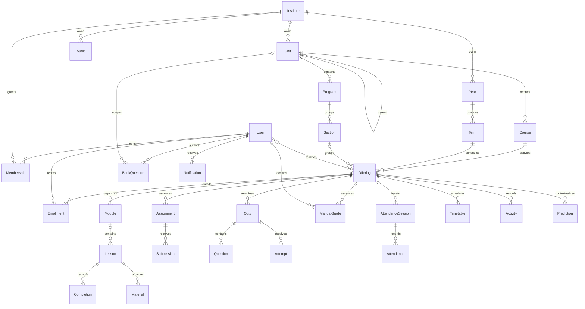

# Database design

UUID primary keys identify protected objects. All domain records have an explicit institute foreign key. Django foreign-key indexes support joins. Database unique constraints protect membership, enrollment, unit names, course codes, academic years/terms, attendance, lesson completion, submissions, and notification event deduplication. Date/time checks and assessment weights are constrained in the database.

Teaching assignments use Django's many-to-many join table. Grades are stored on submissions, quiz attempts and manual assessment records. The gradebook is computed in batched queries from released records; it normalizes the configured category weights over available categories and remains provisional. Audit events record previous/current assignment, manual and manually updated quiz marks. Assignment supporting resources use the same private storage and authorization pattern as course materials.

Cross-table tenant agreement is enforced at the API/service boundary; raw SQL and direct ORM writes can bypass it. There is no PostgreSQL row-level security or composite tenant foreign-key enforcement. Do not expose a separate write surface without reusing scope validation.

Historical records reference users with `PROTECT` where applicable. Some course children cascade on authorized deletion. Prefer archival and membership deactivation; production retention rules require additional policy work before real records are stored.

Continuation migrations add `Program(institute,unit,name)` uniqueness plus a conditional `(institute,name)` key when unit is null, and `Section(program,name)` uniqueness. Existing duplicates must be resolved deliberately; no migration silently deletes/merges academic records. Both new migrations applied successfully to the local SQLite demo; all migrations also applied successfully on PostgreSQL 17, whose full 66-test suite passed.

`PlatformConfiguration` is a singleton enforced by a check constraint (`id=1`). It stores only public platform name, support email, login notice and update time. Its changes use Django admin LogEntry. Institute grading and terminology remain validated JSON fields, and institute configuration updates use tenant Audit events listing changed fields.

PostgreSQL 17 verification now includes four concurrent API race cases, a 2,000-student reporting benchmark and a custom-format dump/restore into an independent database. The restored fixture and 32 migration records were verified. This rehearsal excludes media and off-host recovery. See docs/reporting-benchmark.json and IMPLEMENTATION_PROGRESS.md for current evidence.

Latest backend regression: PostgreSQL 17 **73 passed, no skips** after authentication, reporting and attendance changes. No model changes/migrations were required. The disposable database container was stopped after verification; the existing local SQLite application data was not replaced.
